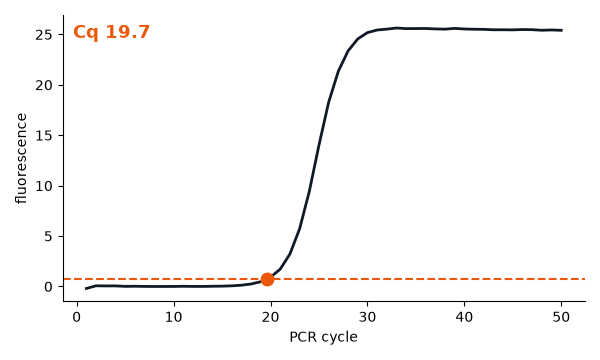
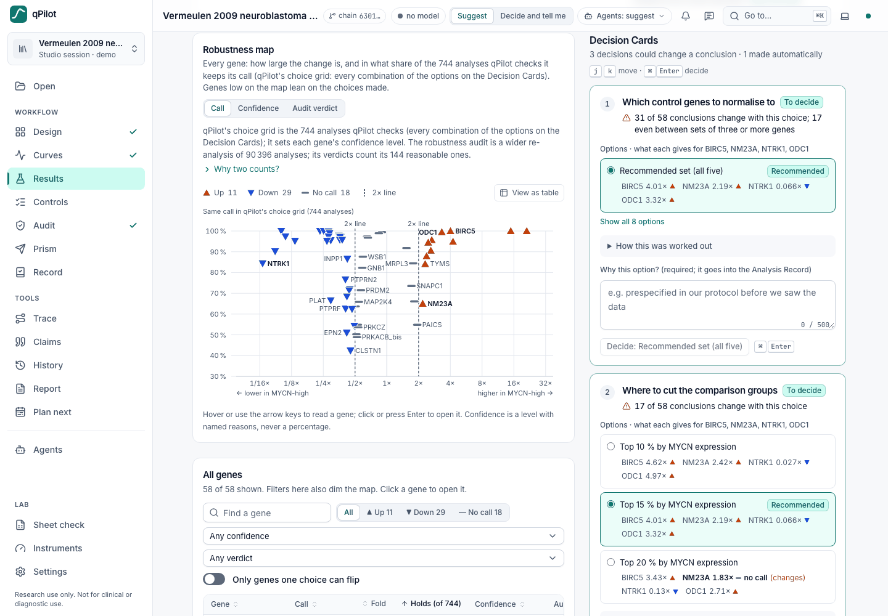
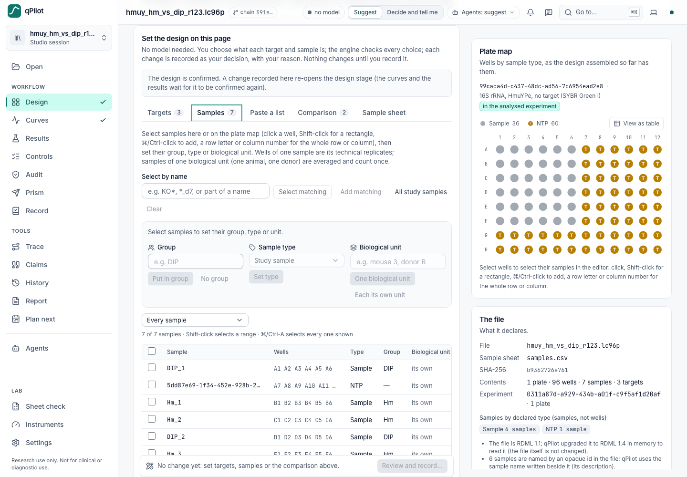
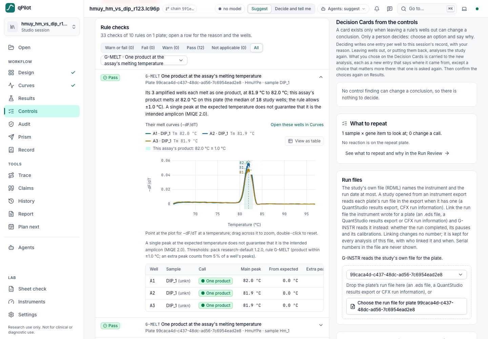
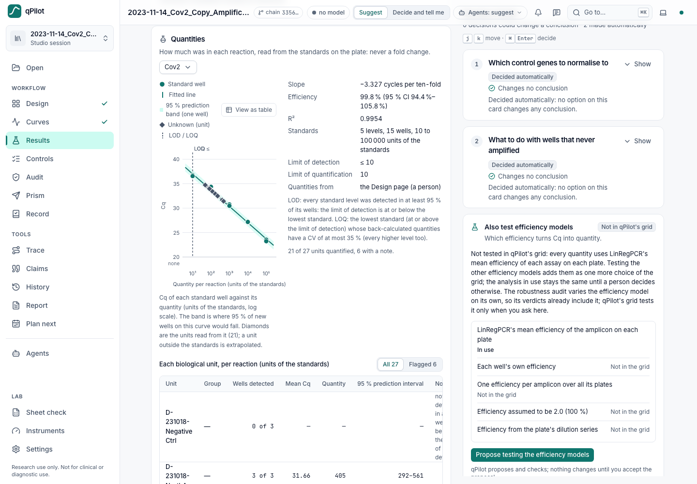
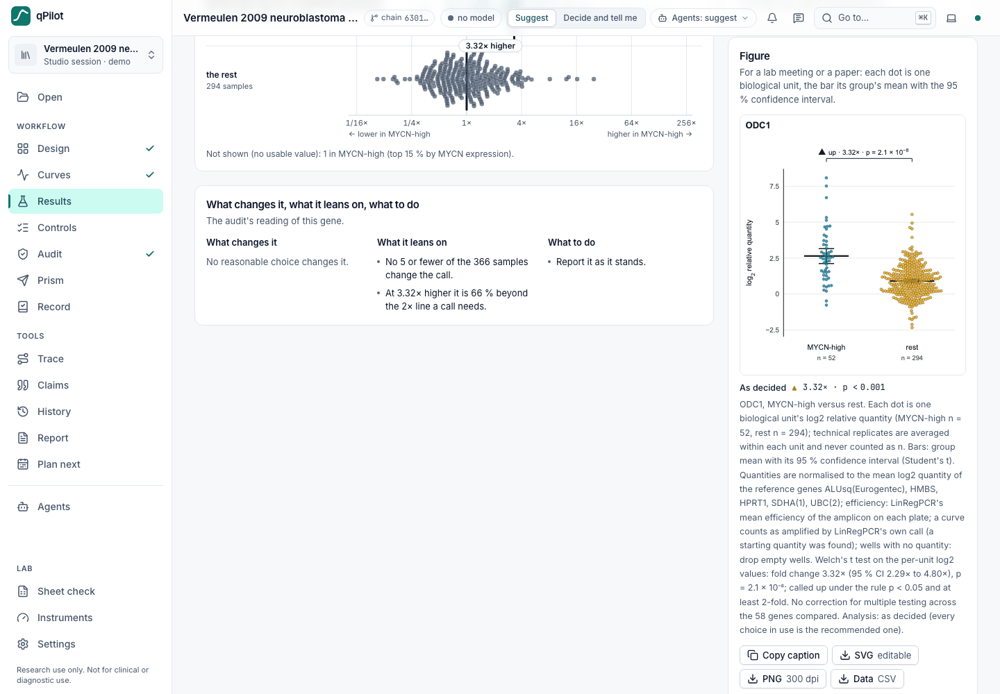
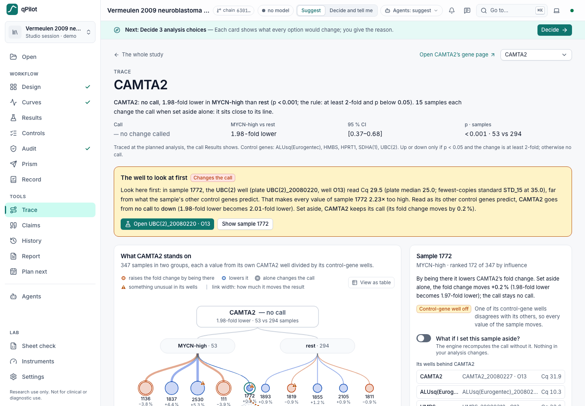
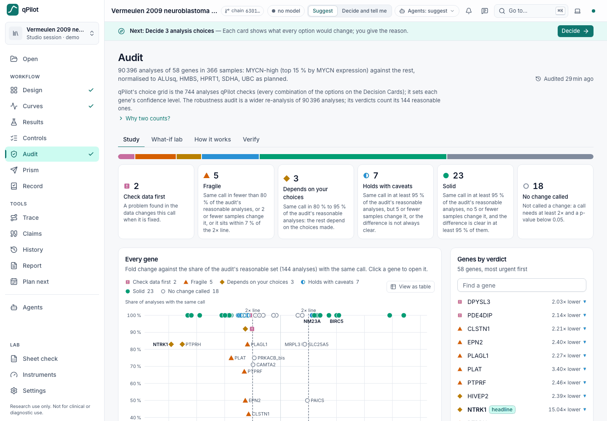
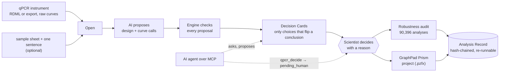

<div align="center">

# qPilot

**Same qPCR data, different reasonable choices, different answers.<br>qPilot shows you which of your choices could change your conclusion, and records who decided.**

[](https://github.com/ShivaTeja05/Qpilot/actions/workflows/ci.yml)
[](LICENSE)


[Quickstart](#quickstart) · [Screenshots](#see-it) · [The page](#the-page) · [How it works](#how-it-works) · [Commands](#commands) · [AI agents](#use-from-an-ai-agent) · [Validation](#validation) · [Docs](#documentation)

**[▶ Try it online: qpilot-navy.vercel.app](https://qpilot-navy.vercel.app)**: the whole page on the public demo study, in a shared sandbox that resets when it restarts (don't upload confidential data).<br>
If the sandbox is asleep, the [read-only demo](https://qpilot-demo-pi.vercel.app) shows the same study from recorded answers.



</div>

> **For research use only. Not for clinical or diagnostic use.**
> Built at *Reinvent the Wheel: A Tools for Science Hack* (London, 16–18 Oct 2026). Licence: Apache-2.0.

---

## Why qPilot

A qPCR result passes through many small choices before it becomes a sentence in a paper: which curves count as amplified, which control genes normalise the rest, how empty wells are treated, where the groups are cut. Each choice is reasonable. Together they can flip a conclusion, and today's tools hide them: the threshold is set per plate inside the vendor software, the ΔΔCt is done by hand in a spreadsheet, and nothing records what was chosen or why.

On the demo study, counting "Cq > 35" as *not detected* changes **10 of 58** conclusions, and the usual spreadsheet route changes **14 of 58**.

qPilot reads the instrument's **raw amplification curves**, analyses every plate with the same published method and settings, and runs **every reasonable analysis** of the same data. It then shows a person only the choices that can change a conclusion. The software decides only what changes no conclusion (with the other choices at their recommended settings), and writes every decision, with its reason and who made it, into a record that anyone can re-run.

<table>
<tr>
<td width="33%" valign="top">

### 🤖 The AI proposes
Fixed rules, an optional language model and the learned Curve Judge propose the study design and the curve calls. They never compute a number.

</td>
<td width="33%" valign="top">

### 🧮 The engine checks
Deterministic statistics (LinRegPCR, geNorm, Welch's t-test) check every proposal and compute every number.

</td>
<td width="33%" valign="top">

### 🧑‍🔬 The scientist decides
A choice that can change a conclusion always waits for a person, whatever an agent or model says. This is enforced in code.

</td>
</tr>
</table>

## What you get

From the instrument's raw curves to a record anyone can re-run, on the same study throughout, in **one page** (`qpilot app`) on your computer:

| | Component | What it does |
|---|---|---|
| 📂 | **Your own files** | RDML (1.0 to 1.4) and instrument exports from Bio-Rad CFX, QuantStudio / StepOne / 7500 and LightCycler 480 / 96, or your own Excel Cq table, read by content and checked for how raw the curves are. Every set of a public corpus of real lab files is listed with what qPilot reads from it: [`docs/conformance.md`](docs/conformance.md) |
| 🧪 | **Studio** (the page's Design and Curves sections) | The AI proposes the design and the curve calls, the engine checks every proposal, and the scientist decides. **A model is optional: the Design can be finished on the page** (targets, groups, standards, biological units, the comparison; [`docs/design-editor.md`](docs/design-editor.md)). Nothing that pairs a group with a number is shown until the design and the curves are confirmed. [`docs/studio.md`](docs/studio.md) |
| 📈 | **Results and Decision Cards** | Every gene's call with its fold change, confidence level and how often the call holds across the analyses qPilot checks; **several comparisons** per study (against a control, every pair, or your list; Holm, Dunnett or Tukey across a gene's comparisons, Benjamini–Hochberg q across genes, paired designs); the choices that could change a conclusion, ranked, for you to decide; and the Evidence Ledger: what this study cannot tell you |
| 🧮 | **Quantities and normalisers** | **Absolute quantification** from the standards on your plate (standard curves, LOD and LOQ, every sample's copies with a 95 % prediction interval; [`docs/quantities.md`](docs/quantities.md)); geNorm and **NormFinder** side by side; other normalisers, efficiency models and corrections between plates tested as further choices when you ask |
| 🔍 | **Where to look** | Controls (the Run Gate, with **melt curves** judged by G-MELT), Trace (from a result, a sample or a well back to the wells that drive it; in Studio, Decide… leaves them out and analyses again), Claims, and the Spreadsheet Check that recomputes your own ΔΔCq sheet |
| 🔬 | **Robustness audit** | The Decision Simulator (`qsim`, in [`sim/`](sim/README.md)) re-runs the confirmed study under every combination of eight analysis decisions, nine with technical replicates (**90,396 analyses** on the demo), gives each gene a verdict, and reproduces qPilot at the baseline. [`docs/integration.md`](docs/integration.md) |
| 🧾 | **Report, exports and the Analysis Record** | Methods, MIQE 2.0 and a passport; a Run Review a person signs off, with **what to repeat and why** and a repeat plate; your **numbers and figures** as an Excel workbook, CSV tables, a figure per gene (SVG, 300-dpi PNG) or a journal supplement ([`docs/exports.md`](docs/exports.md)); and one hash-chained, checksummed zip with the input, results, every decision with its reason and who made it, and the audit, which anyone can verify and re-run |
| 📊 | **Prism** | A **Prism project (`.pzfx`) that opens as it is**: no template, no script; one table per gene, all genes, and who decided what. What changed in the project you save comes back as questions with their consequences. [`docs/prism.md`](docs/prism.md) |
| 📐 | **Plan next** | Before the next plate: samples needed from this study's own noise, what a design cannot detect, and a plate layout; `qpilot plan` adds the replicate budget (biological, RT and technical replicates in one formula) |
| 🧰 | **Instruments** | A registry and a hash-chained logbook per instrument, what each run file says about it (calibration age, run state), incidents a person confirms, and the lookback "which of my conclusions used this period?" |
| 🔌 | **One MCP server** | `qpilot serve`: 32 tools (27 `qpcr_*` and 5 read-only `sim_*`). An agent can read, ask, propose and write a new export file; it cannot overrule a person, and the page shows what an agent is waiting to ask you. [`docs/agents.md`](docs/agents.md) |

[`docs/user-guide.md`](docs/user-guide.md) walks through the page section by section; [`docs/README.md`](docs/README.md) lists every guide and method card.

## See it

<table>
<tr>
<td width="50%" valign="top"><br><sub><b>Results</b> (demo study): every gene's call against how often it holds, and the choices that could change it, waiting for a person.</sub></td>
<td width="50%" valign="top"><br><sub><b>Design, no model</b> (a LightCycler 96 file from Zenodo): select samples or wells, set groups, types and units; each change is recorded with your reason.</sub></td>
</tr>
<tr>
<td valign="top"><br><sub><b>Controls</b> (the same plate): a G-MELT check with its wells' melt curves and the assay's expected Tm ± 1 °C.</sub></td>
<td valign="top"><br><sub><b>Quantities</b> (a QuantStudio 3 wastewater export): the standard curve, efficiency with its 95 % CI, LOD, LOQ and every sample's copies.</sub></td>
</tr>
<tr>
<td valign="top"><br><sub><b>Gene</b> (demo): your samples by group and the figure for a paper, exported as SVG or 300-dpi PNG.</sub></td>
<td valign="top"><br><sub><b>Trace</b> (demo): from a call to the one well worth a look, and what each sample does to it.</sub></td>
</tr>
<tr>
<td valign="top"><br><sub><b>Audit</b> (demo): 90,396 analyses, a verdict per gene from the audit's reasonable set.</sub></td>
<td valign="top"><sub>Screenshots of <code>qpilot app</code> with no model configured. The LightCycler 96 plate is Śmiga &amp; Olczak (2025, Zenodo, CC BY 4.0); the QuantStudio 3 export is SecureBio's airplane-wastewater run (MIT); both are in <a href="tests/fixtures/corpus/README.md"><code>tests/fixtures/corpus/</code></a>, and their designs were set on the page.</sub></td>
</tr>
</table>

## Quickstart

```bash
pipx install git+https://github.com/ShivaTeja05/Qpilot.git   # or: uv tool install git+https://github.com/ShivaTeja05/Qpilot.git
qpilot fetch-demo         # the 64-plate demo study, SHA-256 pinned (7 MB, once)
qpilot app                # the page, on 127.0.0.1 (Ctrl-C to stop)
```

Python 3.11–3.13 on Windows, macOS or Linux; no Node, no compiler. Once qPilot is on PyPI, `pipx install qpilot` (or `uv tool install qpilot`) works too. Windows step by step in PowerShell, macOS notes, offline installs and where your data lives: [`docs/install.md`](docs/install.md). Working on qPilot itself: `git clone https://github.com/ShivaTeja05/Qpilot && cd Qpilot && pip install -e '.[dev,ai]'` in a virtual environment.

`qpilot app` prints a link and opens it. **Use that link**: it carries the key of this launch, without which the page's API answers nothing. On the page, choose **Open the demo study**, or drop your own RDML file, instrument export or Cq table. The page is already built into the package.

Without a browser, the same walk-through can be scripted and checked:

```bash
# Studio end to end, no browser: 28 checks, about 90 s
QPILOT_MODEL_PROVIDER=none qpilot studio demo --check

# All 9 stages (Studio, audit, Prism, record, agents): 30 checks, 3–6 min
QPILOT_MODEL_PROVIDER=none python -m qpilot.integration demo --out demo-run

# The 32 MCP tools this install serves
qpilot serve --list-tools
```

> [!NOTE]
> On macOS the first `qpilot` command after installing can take about 70 s (the first load of native libraries); later calls start in seconds. `--out` must be a new or empty folder.

> [!TIP]
> **The model is optional.** With `QPILOT_MODEL_PROVIDER=none` the fixed rules propose alone, whatever they cannot read from your file you set on the Design page yourself, and every demo number here comes from the rules. Typing the demo's 427 samples twice (854 items), the rules got 839/854 right; qwen2.5:7b 834/854; qwen2.5:14b and qwen2.5:32b 839/854. Safety held for every model: no control missed, nothing accepted without a person ([`docs/studio-measured.md`](docs/studio-measured.md)).

## The page

One hash-routed page, one study at a time. The rail lists the workflow in order, each step with its state (confirmed, proposals waiting, or locked with the reason); the top bar shows the study, the head of the decision chain, the model in use and whether anything is waiting for you; **Ask** (a drawer) answers questions about the open study.

| Section | What it is for |
|---|---|
| **Open** | Drop an RDML file, an instrument export or your own Cq table (and optionally a sample sheet and one sentence about the experiment), open the demo study, or return to a recent workspace |
| **Design** (blind) | Proposals for what each sample and gene is, the groups and the comparison (or several), each checked by the engine; you accept, edit or reject, or **set the design on this page** yourself (targets, samples, a pasted list, the comparison, a pre-filled sample sheet) |
| **Curves** (blind) | Every well's curve and call, its melt curve, the Curve Judge's disagreements as proposals, the call rule |
| **Results** | The robustness map of every gene, the table (per comparison, with corrected p and q), the flip matrix, the Decision Cards, reference genes by geNorm and NormFinder, **Quantities** when the plate has standards, the further choices you can ask qPilot to test, and the Evidence Ledger: what this study can and cannot tell you |
| **Controls** | What the controls on each plate say (the Run Gate, melt curves included), whether leaving their wells out changes a call, and what to repeat |
| **Gene** | One gene: what holds, one choice at a time, your samples with their replicate wells, its wells, and its figure |
| **Audit** | The robustness audit: a verdict per gene, a what-if lab, and how it works |
| **Trace** | Follow any number down to the samples and wells that drive it; **Where to look** for a gene, a sample or a well, and **Decide…** at a place that changes a call (in Studio it leaves the wells out and analyses again); an agent's request to set wells aside waits there for you |
| **Claims** | Check a sentence about the results against the engine's numbers |
| **Sheet check** | Recompute your own ΔΔCq spreadsheet from its Cq values; the first step that differs, and the known slip that reproduces it (the file is never edited) |
| **Prism** | The Prism project (`.pzfx`, no template needed), and the round trip back from the project you saved |
| **Report** | Methods, the MIQE 2.0 checklist, a reviewer's report, the study passport, the **Run Review** a person signs off (with what to repeat and a repeat plate), and the exports: workbook, CSV tables, figures, journal supplement |
| **Record** | The decision chain, export of the Analysis Record, verification of a record |
| **History** | Replay the decisions in order and see what each changed |
| **Plan next** | Samples per group from this study's own noise, what a design cannot detect, and a plate layout |
| **Instruments** | The instrument registry and logbooks, incidents a person confirms, and the lookback over a period |
| **Agents** | How to connect an agent, and what agents are asking or have done |
| **Settings** | The model's status and a test of it, what agents may do on their own (explained here; set for each study in its top bar), theme |

What the page never does: it never makes a choice that can change a conclusion; it never shows a group difference before the design and the curves are confirmed (the server refuses, the page does not merely hide it); it never shows a number the engine did not compute; it never loads anything from the internet on its own (the demo download happens only when you click **Download 7.0 MB and open**); and it never records a decision, a sign-off or an incident confirmation as anyone but the person at the page.

## How it works



The integrated workflow runs nine stages on the same study, from intake to agents. Each stage says who proposes, what the engine computes, what a person decides and what is written:

| # | Stage | AI or rules propose | Engine computes or checks | Person decides |
|---|---|---|---|---|
| 1 | Intake | — | inspect the file; quarantine instruction-like names | drops in the file |
| 2 | Design, blind | design proposals | each one consistent or contradicted | accepts or rejects, with reasons |
| 3 | Curves, blind | Curve Judge | LinRegPCR checks each disagreement | keeps or overrides, confirms |
| 4 | Choices | — | 744 analyses; Decision Cards | decides each card |
| 5 | Audit | — | 90,396 analyses; baseline = qPilot | reads the verdicts |
| 6 | Prism | the draft | log2 per unit; provenance | Send to Prism |
| 7 | Round trip | — | what changed in Prism and what it changes | gives the reason, decides again |
| 8 | Record | — | export, verify, bind the audit | — |
| 9 | Agents | an agent asks over MCP | `qpcr_decide` → `pending_human` | answers on the page |

Full numbers for each stage, and the system diagrams: [`docs/integration.md`](docs/integration.md).

### The engine

All maths is ordinary, deterministic Python; no language model is involved. Steps, method cards and limitations: [`docs/engine.md`](docs/engine.md).

1. **Curves**: LinRegPCR, vendored unchanged from the RDML consortium's rdmlpython, on every plate ([method card](methods/linregpcr.md)).
2. **Control genes**: geNorm stability and the pairwise ratio check between the groups ([method card](methods/genorm.md)).
3. **Comparison**: Welch's t-test on log2 relative quantities (a paired t-test for a paired design), with a stated rule: *up or down only if p < 0.05 and the change is at least 2-fold; otherwise no call* ([method card](methods/contrast.md)). With several comparisons, each gene's p-values are corrected across its comparisons before the rule (Holm; or Dunnett for each group against a control, Tukey for every pair, both from a variance pooled over the groups), and Benjamini–Hochberg q-values across genes are shown beside them ([method card](methods/comparisons.md)). A Decision Card counts a changed call in every comparison.
4. **Robustness**: every combination of the reasonable choices on the same plates (31 control-gene sets × 3 group cut-offs × 2 rules for empty wells on the demo: 186 analyses in `qpilot run`; Studio adds four amplification-call rules, 744), and which choices flip which conclusions. The efficiency model, the normaliser (NormFinder's or geNorm's best pair, the global mean) and a correction between plates join the grid when a person asks ([efficiency](methods/efficiency_model.md), [NormFinder](methods/normfinder.md), [between plates](methods/inter_run_calibration.md)). The Decision Simulator's audit varies eight decisions, nine with technical replicates (90,396 analyses on the demo), and gives its verdicts from its own reasonable set (144 on the demo).
5. **Quantities and melt**, beside the relative analysis: standard curves, LOD, LOQ and copies with a 95 % prediction interval ([method card](methods/absolute_quantification.md)); each well's melt curve, its peaks and Tm, judged by the Run Gate's G-MELT ([method card](methods/melt_curve.md)).

## Where to look, and what the data cannot show

On the page these are the Trace, Results (Evidence Ledger), Report (Run Review, Excel), Sheet check and Instruments sections; the same engines answer on the command line and over MCP:

```bash
qpilot trace --gene CAMTA2            # from a result back to the wells to look at (reads only)
qpilot trace --well HMBS_20080318:K22 # does this one well matter?
qpilot evidence                       # what this study cannot tell you (Evidence Ledger)
qpilot report run-review --repeat --out review.html   # with what to repeat and why
qpilot melt run.rdml                  # each well's melt curve: the product's Tm, extra peaks, controls
qpilot quantify run.rdml              # standard curves, LOD/LOQ and every sample's copies
qpilot check sheet analysis.xlsx      # recompute your own ΔΔCq sheet; the file is never edited
qpilot plan --sd 0.5 --sd-rt 0.4 --sd-well 0.3 --n 6   # biological, RT and technical replicates together
qpilot instrument inspect run.eds     # what the run file says about the instrument
qpilot export xlsx --out results.xlsx   # your numbers as numbers (also csv, figures, supplement)
```

- **Trace** walks from a gene's conclusion, a sample or a well back through the normaliser, the reference wells and the plate controls. It stops at a plate and well, and says what each one does to the conclusion. On the demo, CAMTA2's first place to look is tumour 2016 on plate HMBS_20080318, well K22: one HMBS well reads Cq 46.1 while the tumour's other four reference wells read normally. Reading that well from the other four changes CAMTA2 from no call to down. A trace that would change a call opens a decision only a person can take. On the page, Trace follows the analysis in use (each Decision Card's applied option). Method: [methods/trace.md](methods/trace.md).
- **Evidence Ledger** lists the controls and annotations a study has and lacks: NTCs, no-RT, reference-gene stability, efficiency source, RNA integrity, RT replicates, biological units, inter-run calibrators, lots, instrument dates. Absent items never change a conclusion. Method: [methods/evidence.md](methods/evidence.md).
- **Run Review** is one page per study for the person who reviews someone else's work: the headline genes, the Evidence Ledger, **what to repeat and why** (each sample × gene ranked by what re-running it could change, with a repeat plate to download), the Run Gate per plate, and the recorded sign-offs (accept, repeat or discuss, with a comment and a name, kept in the decision chain). Only a person signs off, on the page.
- **Spreadsheet Check** recomputes a lab's own analysis sheet from its Cq values. It names the first column that differs and the known slip that reproduces it, such as an inverted sign, the exponent applied twice, or statistics run on fold changes. The column mapping is a guess until a person confirms it. Tested on generated sheets only so far. Method: [methods/sheetcheck.md](methods/sheetcheck.md).
- **Instrument Logbook** reads calibration dates, run state and log events from QuantStudio `.eds` and export headers. It keeps a hash-chained logbook per instrument, with events inferred from successive files and incidents a person confirms. Lookback answers "which of my conclusions used this period?". The formats are tested on synthetic files built to the layouts seen in public files; several are unverified (see [methods/instrument_context.md](methods/instrument_context.md) and [methods/lookback.md](methods/lookback.md)).

## Commands

| Command | What it does |
|---|---|
| `qpilot fetch-demo` | Download the public 64-plate demo study (pinned, SHA-256 verified) |
| `qpilot app` | The one page on 127.0.0.1 (never shared); `qpilot app --fresh-demo` moves earlier decisions aside (they are kept, never deleted) |
| `qpilot studio demo --check` | Studio end to end without a browser (`qpilot studio` itself opens the page) |
| `qpilot run` | Analyse a study: results, robustness, confidence and Decision Cards (186 analyses of the demo); `--efficiency`, `--normaliser`, `--interrun` add further choices to the grid |
| `qpilot plan` | Before the first plate: samples needed (with the replicate budget) and what a design cannot detect |
| `qpilot trace` | From a gene's result, a sample or a well back to the places to look (reads only) |
| `qpilot evidence` | What a study can and cannot tell you (the Evidence Ledger; reads only) |
| `qpilot report run-review` | The Run Review page of a study, with `--repeat` what to repeat and the repeat plate (renders only; a person signs off on the page) |
| `qpilot check sheet` | Recompute a lab's own ΔΔCq sheet; `--confirm` / `--map COL=ROLE` confirm the column mapping |
| `qpilot instrument` | What run files say about instruments: `inspect`, `list`, `add`, `history`, `lookback`, `position` |
| `qpilot melt` | Each well's melt curve from an RDML file or an export: the product's Tm per plate and target, extra peaks, controls (reads only) |
| `qpilot quantify` | Absolute quantification: standard curves, LOD/LOQ and every unknown's copies with a 95 % prediction interval |
| `qpilot copies` | ng of a standard to copies (dsDNA, ssDNA, RNA) and its dilution series |
| `qpilot explain` | Print one explanation template rendered from a study's facts |
| `qpilot validate` | Reproduce the RDML consortium's published benchmark on the demo study |
| `qpilot doctor` | Versions, the dataset, the model provider and what can leave this machine (`outbound: none` without a model) |
| `qpilot serve` | The MCP server for AI agents, over stdio |
| `qpilot harness` | Score a model on your own study before trusting it (`make`, `run`, `show`) |
| `qpilot record` | Write the Analysis Record of a study, e.g. one decided in Studio |
| `qpilot verify` | Check a record's checksums, decision chain and proposal chain |
| `qpilot rerun` | Re-run a record and compare results byte for byte |
| `qpilot export` | `xlsx` (or `excel`), `csv`, `figures`, `supplement`: your numbers, figures or a journal supplement, as decided; `prism`: a Prism project (`.pzfx`) that opens as it is |
| `qpilot prism` | After Prism: `prism diff` shows what changed; `prism verify` checks a bundle |
| `qsim …` | The Decision Simulator: `demo`, `run`, `ask`, `whatif`, `validate` ([`sim/README.md`](sim/README.md)) |
| `python -m qpilot.integration` | The integrated workflow: `demo`, `audit --study <id>`, `verify` |

## Use from an AI agent

```bash
claude mcp add qpilot -- qpilot serve
```

`qpilot serve` is the one MCP server: qPilot's 27 `qpcr_*` tools and, when the Decision Simulator imports (it installs with this package), its 5 read-only `sim_*` tools over an audit; `qpilot serve --list-tools` prints what your install serves. It reads and writes the same study store as the page. Every tool has a title, honest annotations and an output schema, and every refusal says what went wrong, a stable code and what to do next.

An agent can read the study, ask what each choice would change, and request a decision:

```
run → qpcr_study → qpcr_robustness → qpcr_decide → pending_human → (scientist decides on the page) → record
```

A choice that can change a conclusion (with the other choices at their recommended settings) becomes a request that waits for a person, whatever the agent says; that check is made once, when the study is analysed. Every MCP caller is recorded as an agent, and `actor="human"` is refused. No tool can accept, edit or reject a Studio proposal, sign off a run review or confirm an instrument incident. An agent can ask a person to set wells aside (`qpcr_request_set_aside`: the request waits in Trace, at the place, for **Approve** or **Turn down**), and `qpcr_export` writes new export files only, never over a file, and decides nothing.

> [!IMPORTANT]
> The gate binds agents whose only access to qPilot is MCP (the page's Ask never writes at all). An agent that can run commands as you can still act as you. Give agents MCP access, not your shell.

The full guide, including models inside qPilot (`QPILOT_MODEL_PROVIDER` = `none`, `anthropic` or `openai_compatible`) and how to test a model before trusting it with the harness, is [`docs/agents.md`](docs/agents.md).

## Validation

`qpilot validate` compares the engine with the RDML consortium's own published results for the demo study's dilution standards (tables fetched SHA-256-pinned). Generated lines, exactly as `qpilot validate` prints them from the numbers in `validation/validation.json`:

- N0 on 930 standard wells (62 genes) vs RDML-Tools: 99.6 % identical to 4 significant figures, 100.0 % within 5 % (largest difference 0.05 %)
- Dilution-series bias over 62 genes vs LinRegPCR (2013): median |difference| 0.021 (ours 0.961 vs published 0.947 on average)
- Cq on 945 standard wells (63 genes) vs LinRegPCR (2013): offset +0.97 cycles on average (SD 0.17), a change in how LinRegPCR defines Cq, disclosed

Full table and sources: [`validation/validation_table.md`](validation/validation_table.md). The Decision Simulator adds known-answer tests against digital PCR on four qPCR machines, planted faults in real data, and no-difference tests ([`sim/README.md`](sim/README.md)); Trace has its own planted-fault benchmark ([methods/trace.md](methods/trace.md)).

## The Analysis Record

Export writes one zip: the input RDML (byte for byte, when the original file is still on disk; the export message says so), the results, the cards, the robustness grid (`grid.csv`), the facts every sentence cites, the design, every decision with its reason and who made it (`human`, `agent` or `system`), the run reviews, the software versions and the vendored method's commit, and a `CHECKSUMS.sha256`.

```bash
qpilot record --study <id> --out rec      # the record of a study decided in Studio (the id the page shows)
qpilot verify qpilot-record-<study>.zip   # checksums and the decision chain
qpilot rerun <unzipped record folder>     # re-runs the analysis from the record's input; compares results.json
```

The re-run reproduces the results at the recommended choices (a decision is recorded with its reason; it does not change `results.json`; each option's consequences are in `cards.json` and `grid.csv`). It reuses the local curve cache; set `QPILOT_CACHE_DIR` to an empty folder to re-fit every curve.

<details>
<summary><b>How tamper-evident is it?</b></summary>

Decisions are a hash chain: each entry carries the hash of the one before, so an entry edited or removed without recomputing the hashes is detected (a removed last entry through `CHECKSUMS.sha256`). Nothing is signed: someone who recomputes every hash is not detected unless the record id is compared with a copy kept elsewhere. That makes the record tamper-evident against accidental or naive edits, not tamper-proof; it is not a 21 CFR Part 11 system.

</details>

## Will it work in my lab?

| | |
|---|---|
| RDML export from the instrument | ✔ RDML 1.0 to 1.4, including zipped files whatever their member is called (LightCycler 96 `.lc96p`, CFX Manager), StepOne's RDML 1.0 and LinRegPCR-written RDML; every RDML file of the public corpus opens, one file at a time ([`docs/conformance.md`](docs/conformance.md)) |
| Instrument exports (Bio-Rad CFX, QuantStudio / StepOne / 7500, LightCycler 480, tidy tables) | ◐ dropped on the page's Open (one file or a whole export set), read by content and converted once into RDML; every real qPCR export set of the corpus opens (an isothermal plate read is refused: it is not a PCR run). The page says how raw the curves are, and a baseline-subtracted or unknown export is analysed with every confidence grade capped until a person decides |
| My own Excel Cq table (Sample, Gene, Condition, Gene Type, Cq), or an RDML file without curves | ✔ opens alone or beside the run file (its Gene Type column proposes the reference genes, its condition column becomes the sample sheet) and is analysed end to end from the Cq values: efficiency from the plate's dilution series, else assumed 2.0, with confidence capped at Low or Moderate because no curve could be checked ([`docs/cq-tables.md`](docs/cq-tables.md)) |
| QuantStudio `.eds` | ◐ for the analysis, export the curves with Thermo's own tools first; `qpilot instrument inspect` reads the file's calibration dates, run state and log events (synthetic test files only) |
| Offline on a laptop, no account | ✔ (macOS: full analysis tested with the network off; Linux: tests in CI; Windows: in CI, tests and the installed wheel, not yet used on an instrument PC) |
| Reproduces my lab's numbers | ◐ reproduces the published benchmark above; your own instrument is untested. Melt: 96 of 96 wells of a CFX96 SYBR plate within 0.5 °C of CFX Manager's Tm |
| My own study design | ✔ set on the page with no model (targets, groups, standards, units, the comparison; [`docs/design-editor.md`](docs/design-editor.md)), proposed from your file, sheet and one sentence, or `qpilot run --design study.yaml --samples sheet.csv` |
| More than two groups, paired samples | ✔ several comparisons (each against a control, every pair, or your list), set on the Design page; Holm, Dunnett or Tukey across a gene's comparisons, Benjamini–Hochberg q across genes; paired by donor, animal or passage. Results, Trace, a gene's page and History follow the comparison you pick |
| Technical replicates | ✔ averaged per biological unit (mean of log2 quantities); never counted as n; a group with fewer than two biological units gets no p-value; the robustness audit combines them the same way |
| Absolute quantities (copies) | ✔ from the standards on the plate: standard curves, LOD, LOQ, copies with a 95 % prediction interval, per µL or ng once you give the reaction input. A plate with no group comparison (a viral load) has no Results page yet: use `qpilot quantify` |
| Melt curves | ✔ SYBR Green / EvaGreen assays exported with their melt curves (RDML, CFX melt RFU, QuantStudio melt data, StepOne melt sections): G-MELT in Controls |
| Which curves count as amplified | ✔ LinRegPCR by default; "Cq ≤ 40 / 38 / 35" are shown as choices with their consequences (on the demo, "Cq > 35 = not detected" changes 10 of 58 conclusions); the learned Curve Judge is a second opinion whose disagreements a person resolves (validated on the demo's LightCycler 480 SYBR only) |
| Results as tables and figures | ✔ Excel workbook, CSV tables, a figure per gene (SVG, 300-dpi PNG) and a journal supplement, as decided on the Decision Cards ([`docs/exports.md`](docs/exports.md)) |
| Results written back into RDML | ◐ the journal supplement carries your RDML with qPilot's Cq (always), N0 and efficiency (RDML 1.3 and later) and the wells left out, with the reason |
| Prism export | ◐ Send to Prism / `qpilot export prism` write a Prism project (`.pzfx`) built to GraphPad's file format: one table per gene, all genes, and an Info sheet with who decided what; no template. **Not yet opened in a real Prism seat** ([docs/prism.md](docs/prism.md)). Not affiliated with GraphPad Software or Dotmatics |
| Hash-chained record of every decision | ✔ (tamper-evident; not Part 11) |

## Demo dataset

Vermeulen J *et al.* (2009) *Lancet Oncology* 10:663–671; raw curves from Ruijter JM *et al.* (2013) *Methods* 59:32–46; CC BY 4.0 (the licence of the CRAN `vermeulen` and `ruijter` packages that redistribute the data). qPilot downloads the copy in the RDML consortium's rdmlpython repository at a pinned commit.

**64 plates** (one gene per plate) · **366 neuroblastoma tumours** · **24,576 reactions** · **5 candidate control genes**. The demo groups are **MYCN-high (the top 15 % by MYCN expression) versus the rest**: expression-defined, not the clinical MYCN amplification call.

## Limitations

- Your own design goes through the page's Design section, or `qpilot run --design study.yaml --samples sheet.csv`; Plan next and `qpilot plan` size a design before the first plate. `qpilot run` without a design analyses the demo's.
- One gene per plate in the demo, so plate effects cannot be separated from gene effects; there is no plate-effect model. The correction between plates (inter-run calibrator, factor correction) is tested on synthetic tables only.
- Technical replicates are averaged per biological unit in a confirmed design, and the robustness audit combines them the same way. In the demo each tumour has one well per gene; only standards and controls are in triplicate. No kinetic outlier test.
- Curve analysis (N0, Cq, dilution bias) is validated against published results on the standards of one study from one instrument platform (LightCycler 480, SYBR Green I). The later steps (geNorm, NormFinder, the contrast, robustness) are tested against reproduced numbers, not a published benchmark; NormFinder has not been checked against the paper's own example (its data are not redistributed).
- The call rule uses no correction for testing many genes (Benjamini–Hochberg q-values are shown beside p for reference); with several comparisons, each gene's p-values are corrected across its comparisons (Holm, Dunnett or Tukey, a person's choice). The robustness check measures sensitivity to analysis choices, not significance.
- With several comparisons, the robustness audit audits the first one and says so, and refuses a paired or pooled-variance (Dunnett, Tukey) comparison or one whose correction changes a call; MCP `qpcr_units` serves the first comparison (the others are in `qpcr_export`'s Per unit table).
- A file with Cq values and no curves is analysed from its Cq values; what needs a curve (LinRegPCR's per-well fit, the Curve Judge, melt) does not apply, and its confidence is capped.
- Absolute quantification counts a standard well that has a quantity even when LinRegPCR calls it "no amplification": on one real eDNA standard curve three flat wells give 154 % efficiency (87 % without them). Check a standard curve's wells and leave flat ones out in Curves ([science review](docs/science-review-2026-10.md), J1).
- A plate with standards and no group comparison (a viral load) cannot reach Results on the page; `qpilot quantify` gives its quantities. No MCP tool reads quantities yet.
- Outside Studio, a Trace decision is recorded only; open the file in Studio to apply it.
- The Prism project has not yet been opened in a real Prism seat; the table of all genes needs Prism 9 or later.
- The exports and the Prism project refuse a study whose group name holds a character other than letters, digits, spaces and `_ - . ( )` (a group named "LPS + inhibitor"): give the group a plain name on the Design page.

## Security and privacy

- The page's server binds to `127.0.0.1` only and is never shared. Every request to its API must carry the key of the launch (the link `qpilot app` prints; the key is kept in an `HttpOnly`, `SameSite=Strict` cookie and removed from the address bar on the first load), requests for any other host name are refused, and so are writes from another site.
- A strict Content-Security-Policy means the page loads nothing from the internet (its code and fonts are bundled), the server serves only the page's own files, and telemetry is switched off.
- The whole analysis runs with the network switched off (`tests/core/test_offline.py`). RDML files are parsed without external entities or network access and with size caps.
- A model sees facts, never raw curves; it may write numbers only as fact tokens, and a validator rejects any other digit. Text in a file that reads like an instruction is quoted, marked and never obeyed. A remote model sees sample names only as pseudonyms.
- Instrument serial numbers stay in the local registry; no page view or tool returns them.
- Names from your files stay text in every file qPilot writes: no workbook cell is a formula, every CSV a person opens defuses `= + - @`, and figures and HTML reports escape every name.

Threats and mitigations: [`THREAT_MODEL.md`](THREAT_MODEL.md); the latest review: [`docs/security-review-2026-10.md`](docs/security-review-2026-10.md) (and of the science: [`docs/science-review-2026-10.md`](docs/science-review-2026-10.md)). Reporting a vulnerability: [`SECURITY.md`](SECURITY.md).

## Repository layout

```
qpilot/
├── io/, qpcr/, vendor/     RDML loading and instrument connectors, the qPCR engine, LinRegPCR vendored unchanged
├── core/                   robustness grid, Decision Cards, the human gate, facts, store, record, instruments
├── trace/, claims/, history/, report/   the page's Trace, Claim Auditor, decision replay, report and Run Review
├── ai/, agents/            model client, Design Interpreter, Prism draft, number validator; the MCP surface
├── harness/                scores a model on your own study before you trust it
├── prism/                  the GraphPad Prism bridge (tables, script, round trip)
├── integration/            the nine-stage workflow and the sim_* MCP tools
├── web/                    the one page's local server (FastAPI) and the built page
├── studio_service.py       qPilot Studio's service (proposals, stages, the inbox)
├── mcp_server.py           qpilot serve
└── cli/                    the command line (qpilot …)
frontend/                   the page's source (React, TypeScript); built into qpilot/web/static
sim/                        the Decision Simulator (qsim): the robustness audit
methods/                    method cards: LinRegPCR, geNorm, NormFinder, the contrast, comparisons, melt, quantities, Trace, …
scripts/                    the merge gate, the demo regression, the corpus conformance table, release checks
validation/                 the published benchmark and its generated table
docs/                       install, the user guide, the page's spec, Studio, engine, agents, exports, Prism, conformance
training/                   the Curve Judge's training code
tests/                      unit, integration, page API and demo-data tests
```

## Documentation

| Guide | Read it for |
|---|---|
| [`docs/README.md`](docs/README.md) | every guide and method card, in one list |
| [`docs/install.md`](docs/install.md) | installing on Windows, macOS and Linux; where your data lives |
| [`docs/user-guide.md`](docs/user-guide.md) | the page, section by section, and how to do each task |
| [`docs/conformance.md`](docs/conformance.md) | which instrument files qPilot reads, set by set |
| [`docs/design-editor.md`](docs/design-editor.md) | setting the design on the page, with no model |
| [`docs/quantities.md`](docs/quantities.md) | absolute quantification: standard curves, LOD, LOQ, copies |
| [`docs/cq-tables.md`](docs/cq-tables.md) | analysing a table of Cq values (no curves): what works, what does not |
| [`docs/exports.md`](docs/exports.md) | what the workbook, CSV tables, figures and supplement hold |
| [`docs/app.md`](docs/app.md) | the page's build spec: sections, API, design system |
| [`docs/studio.md`](docs/studio.md) | qPilot Studio, step by step |
| [`docs/engine.md`](docs/engine.md) | the engine's steps, method cards and limits |
| [`docs/integration.md`](docs/integration.md) | the nine-stage workflow, its numbers and diagrams |
| [`docs/agents.md`](docs/agents.md) | MCP tools, models inside qPilot, the harness |
| [`docs/prism.md`](docs/prism.md) | the Prism project and its round trip |
| [`docs/studio-measured.md`](docs/studio-measured.md) | measured model runs, 7B to 32B |
| [`sim/README.md`](sim/README.md) | the Decision Simulator |
| [`docs/release.md`](docs/release.md) | how a release is made |
| [`CHANGELOG.md`](CHANGELOG.md) | what changed in each version |
| [`THREAT_MODEL.md`](THREAT_MODEL.md) | threats and mitigations |

## Development

```bash
pip install -e '.[dev,ai,studio,sim]'
ruff format --check . && ruff check .
pytest -q -m "not demo_data"      # what CI runs (Python 3.12)
pytest -q                         # everything, after qpilot fetch-demo
cd frontend && npm ci && npm run typecheck && npm run lint && npm test && npm run build   # the page
```

CI runs lint, `pip-audit`, the unit tests on Ubuntu (Python 3.11–3.13), macOS and Windows, and a smoke test of the installed wheel on every pull request (Windows does not block a merge yet). Contributions: [`CONTRIBUTING.md`](CONTRIBUTING.md).

## Built and borrowed

**Borrowed, credited, unchanged:** LinRegPCR (rdmlpython, MIT, vendored at `fce7a44`); the RDML format and schemas; the geNorm method (Vandesompele *et al.* 2002) and NormFinder (Andersen *et al.* 2004), both reimplemented from the papers; SciPy's t distribution; the demo data, the published benchmark tables and the public instrument files of the test corpus.

**Built here:** the hardened RDML loader, instrument connectors and pinned downloads; the per-plate curve table; quantities, groups, geNorm, the contrast and its rule; the reference-gene group check; the decision space and robustness grid; Decision Cards and the escalation rule; the on-disk study store; the Analysis Record and its hash chain; confidence grades; templated explanations whose numbers are all facts; the one page and its local server (`qpilot/web/`, `frontend/`); qPilot Studio's service and the Prism bridge; the Run Gate, melt-curve analysis, Trace, the Evidence Ledger, the Run Review and its repeat plan, the Spreadsheet Check and the instrument logbook; several comparisons, absolute quantification, the exports and the Prism project writer; the Design editor; the Decision Simulator (`sim/`) and the integrated workflow (`qpilot/integration/`); the MCP server; the model layer and its test harness; `qpilot plan`; the validation script.

## Related tools and cost

- **Clarida** ([clarida.bio](https://clarida.bio)), from the authors of geNorm, qbase+ and the MIQE guidelines: analysis from Cq values with geNorm, a MIQE compliance score and methods text. qPilot uses their method and starts one step earlier, from the raw curves.
- **LinRegPCR web / RDML-Tools** ([rdml.org](https://www.rdml.org)): the reference curve-analysis method, file by file, which qPilot ships unchanged and runs on every plate of a study.
- **AnnealIQ**: a conversational qPCR analysis assistant (closed beta) working from Ct values.

For the analysis-and-statistics step, Clarida's Lab plan is listed at €4,800–9,600 a year ([clarida.bio/pricing](https://clarida.bio/pricing); academic pricing is lower and not listed), and GraphPad Prism at $260–520 per seat a year ([graphpad.com/how-to-buy](https://www.graphpad.com/how-to-buy)). qPilot is Apache-2.0 and runs on a laptop. It does not replace the instrument's own software, validated (Part 11) editions, or Prism for non-qPCR work.

## Roadmap (not built)

- The Prism project opened and round-tripped in a real Prism seat
- The robustness audit for every comparison, paired and pooled-variance designs included, not only the first
- Quantities on the page for a plate with no group comparison, and an MCP tool for them
- A plate effect (plate as a random effect) once a gene spans two or more plates
- qPilot on PyPI (`pipx install qpilot`), and Windows used on an instrument PC

## Licence and citation

qPilot is Apache-2.0 ([`LICENSE`](LICENSE)). Third-party licences, data and the generated package list are in [`THIRD_PARTY_NOTICES.md`](THIRD_PARTY_NOTICES.md); a CycloneDX bill of materials can be generated with `cyclonedx-py environment -o sbom.json` (not committed; it will be attached to tagged releases, none yet). To cite qPilot and the methods it builds on, see [`CITATION.cff`](CITATION.cff).
