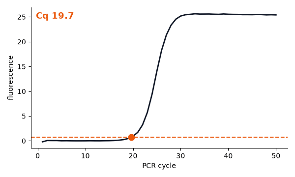
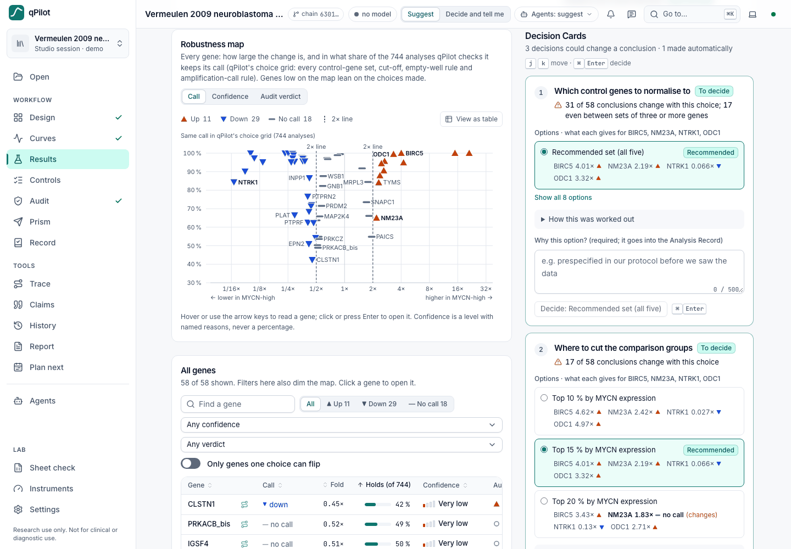
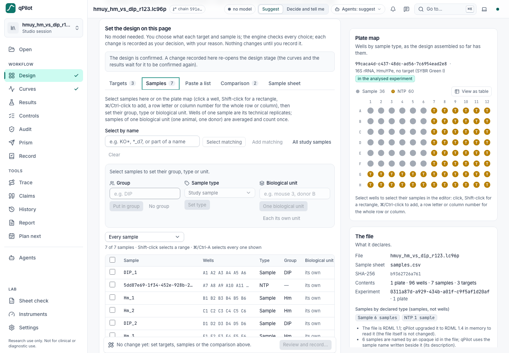
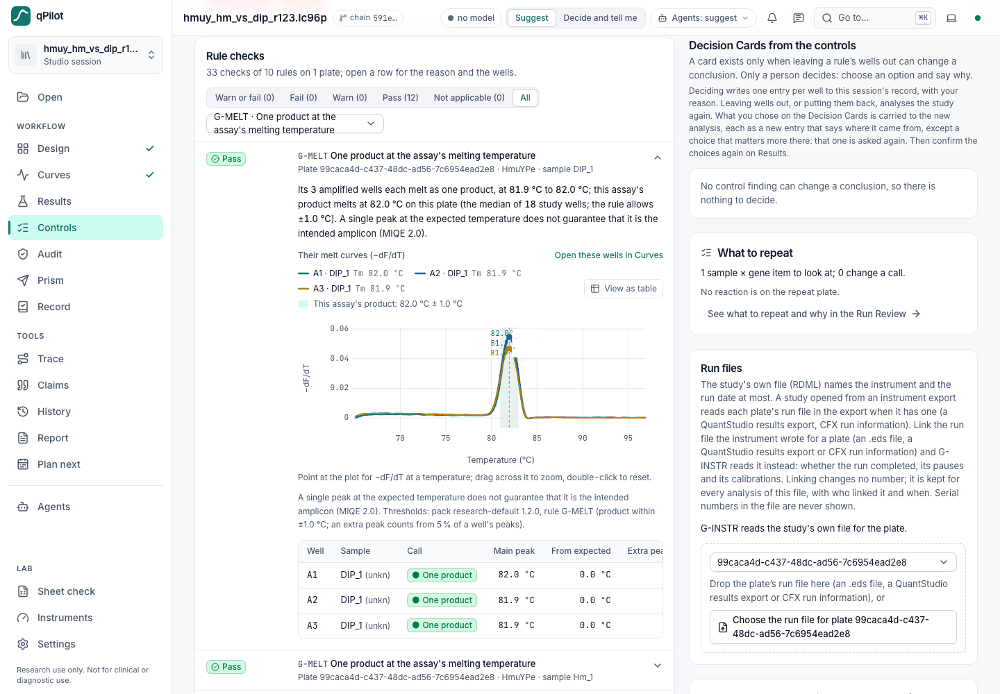
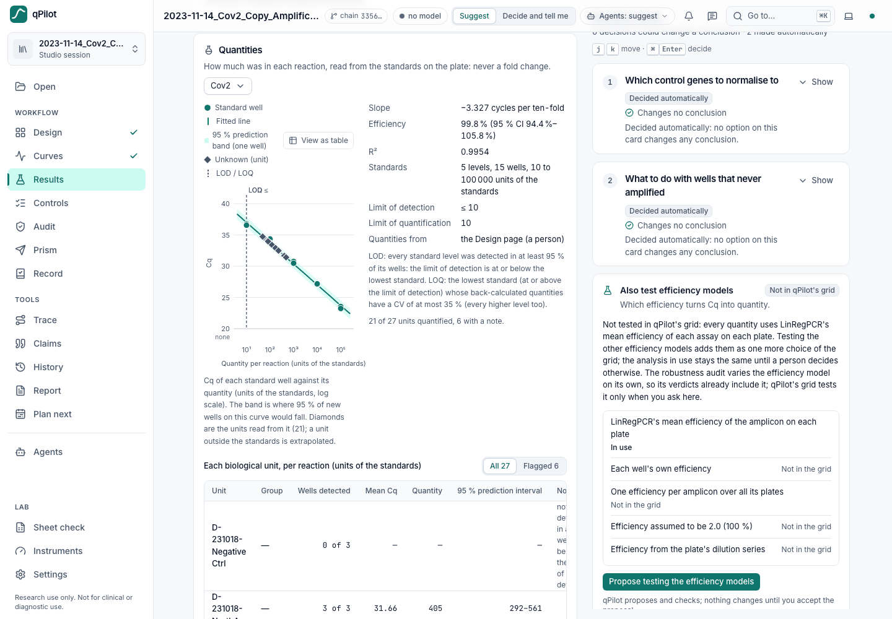
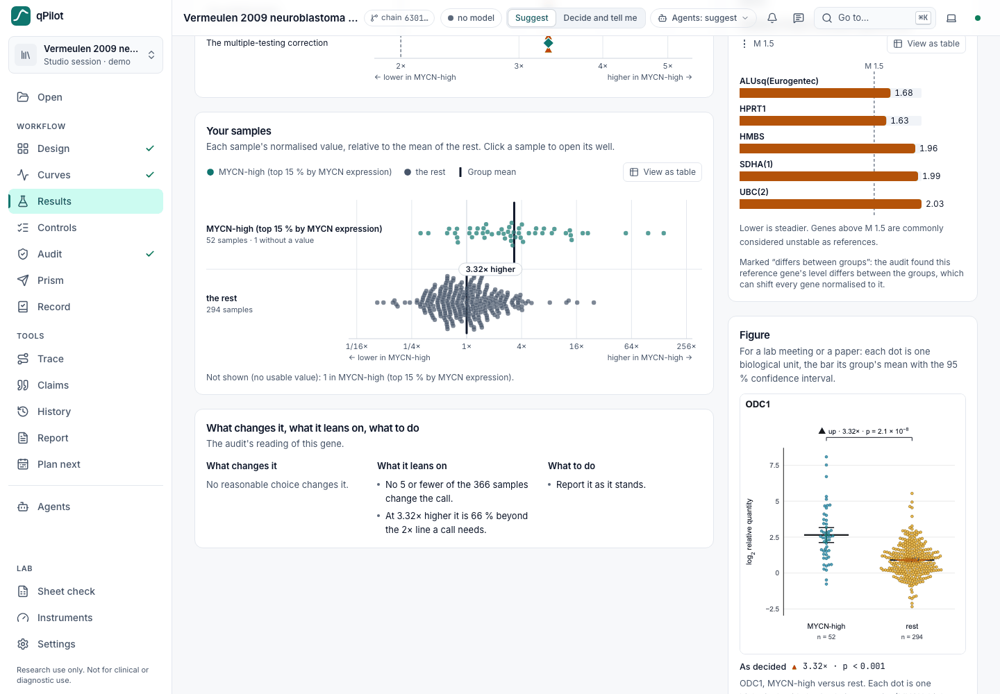
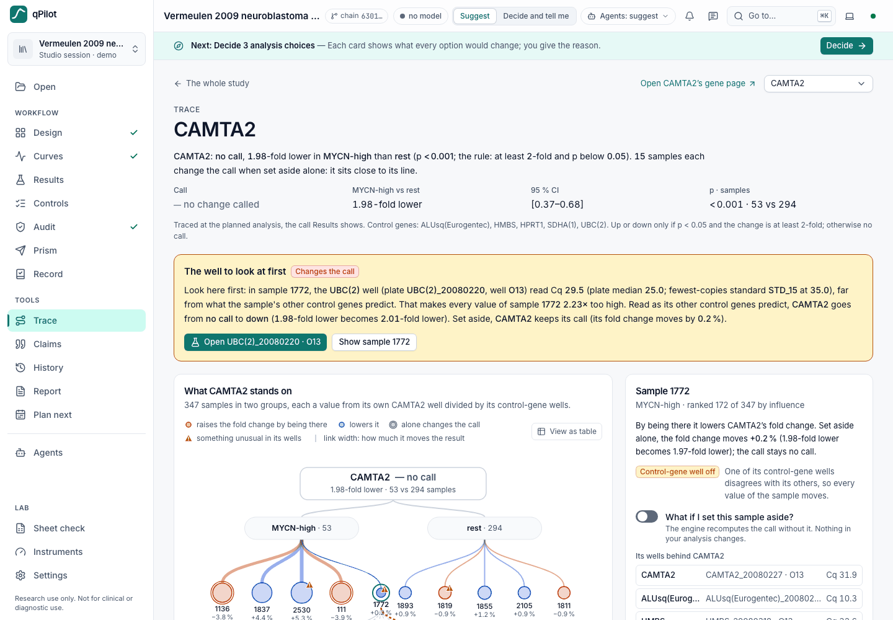
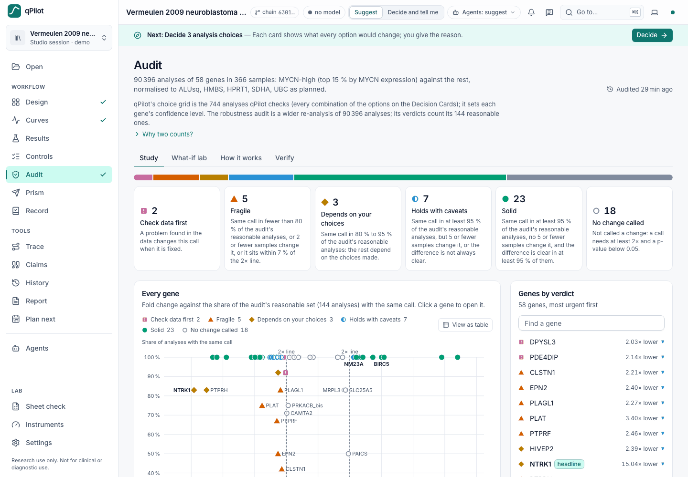
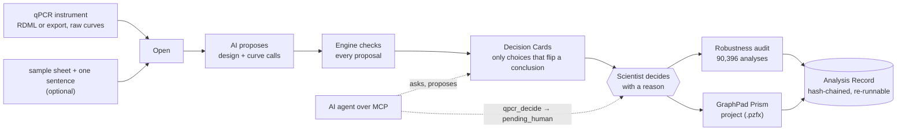

<div align="center">

# qPilot

### Same qPCR data. Different reasonable choices. Different answers.

**qPilot shows you which of your analysis choices could change your conclusion, lets *you* decide them, and records who decided what, and why.**

[](https://github.com/ShivaTeja05/Qpilot/actions/workflows/ci.yml)
[](https://pypi.org/project/qpilot/)

[](LICENSE)


**[▶ Try it online](https://qpilot-navy.vercel.app)** · [Quickstart](#-quickstart) · [Screenshots](#-see-it) · [How it works](#-how-it-works) · [Commands](#-commands) · [AI agents](#-use-from-an-ai-agent) · [Validation](#-validation) · [Docs](#-documentation)



</div>

> [!WARNING]
> **For research use only. Not for clinical or diagnostic use.**
> Built at *Reinvent the Wheel: A Tools for Science Hack* (London, 16–18 Oct 2026).

---

## 💡 Why qPilot

A qPCR result passes through many small choices before it becomes a sentence in a paper: which curves count as amplified, which control genes normalise the rest, how empty wells are treated, where the groups are cut. Each choice is reasonable. Together they can **flip a conclusion**, and today's tools hide them: the threshold is set per plate inside the vendor software, the ΔΔCt is done by hand in a spreadsheet, and nothing records what was chosen or why.

> On the public demo study, counting "Cq > 35" as *not detected* changes **10 of 58** conclusions. The usual spreadsheet route changes **14 of 58**.

qPilot reads the instrument's **raw amplification curves**, analyses every plate with the same published method, and runs **every reasonable analysis** of the same data. It then puts in front of a person **only the choices that can change a conclusion**. Everything else it settles itself, and every decision goes into a hash-chained record, with its reason and who made it, that anyone can re-run.

<table>
<tr>
<td width="33%" valign="top">

### 🤖 The AI proposes
Fixed rules, an optional language model and the learned Curve Judge propose the study design and the curve calls. **They never compute a number.**

</td>
<td width="33%" valign="top">

### 🧮 The engine checks
Deterministic statistics (LinRegPCR, geNorm, NormFinder, Welch's t-test) check every proposal and compute **every number**.

</td>
<td width="33%" valign="top">

### 🧑‍🔬 The scientist decides
A choice that can change a conclusion **always waits for a person**, whatever an agent or model says. The server enforces this; the page doesn't just hide it.

</td>
</tr>
</table>

## 🚀 Quickstart

```bash
pipx install qpilot       # or: uv tool install qpilot
qpilot fetch-demo         # the 64-plate demo study, SHA-256 pinned (7 MB, once)
qpilot app                # opens the page on 127.0.0.1 (Ctrl-C to stop)
```

That's it: Python 3.11–3.13 on Windows, macOS or Linux, with no Node, no compiler and no account. `qpilot app` prints a link and opens it. **Use that link**: it carries this launch's key, and without the key the page's API answers nothing. Then choose **Open the demo study**, or drop in your own RDML file, instrument export or Cq table.

> [!TIP]
> **No model needed.** With `QPILOT_MODEL_PROVIDER=none`, fixed rules make the proposals and you finish the design on the page. Every number in this README comes from the rules. On the demo's 854 design items the rules got 839 right; qwen2.5:7b got 834, and 14B and 32B got 839. Safety held for every model: no control was missed and nothing was accepted without a person ([`docs/studio-measured.md`](docs/studio-measured.md)).

<details>
<summary><b>No browser? Script it and check it</b></summary>

```bash
# Studio end to end, no browser: 28 checks, about 90 s
QPILOT_MODEL_PROVIDER=none qpilot studio demo --check

# All 9 stages (Studio, audit, Prism, record, agents): 30 checks, 3–6 min
QPILOT_MODEL_PROVIDER=none python -m qpilot.integration demo --out demo-run

# The MCP tools this install serves
qpilot serve --list-tools
```

On macOS the first `qpilot` command after installing can take about 70 s while native libraries load for the first time; later calls start in seconds. `--out` must be a new or empty folder.

</details>

<details>
<summary><b>Other ways to install</b></summary>

- **Latest from GitHub:** `pipx install git+https://github.com/ShivaTeja05/Qpilot.git`
- **Windows step by step (PowerShell), macOS notes, offline installs, where your data lives:** [`docs/install.md`](docs/install.md)
- **Hacking on qPilot:** `git clone https://github.com/ShivaTeja05/Qpilot && cd Qpilot && pip install -e '.[dev,ai]'` in a virtual environment (see [Development](#-development))
- **No install at all:** [qpilot-navy.vercel.app](https://qpilot-navy.vercel.app) runs the whole page on the demo study in a shared sandbox that resets on restart (don't upload confidential data). If the sandbox is asleep, the [read-only demo](https://qpilot-demo-pi.vercel.app) replays the same study from recorded answers.

</details>

## ✨ What you get

From the instrument's raw curves to a record anyone can re-run, in **one local page** (`qpilot app`):

| | Feature | What it does |
|---|---|---|
| 📂 | **Your own files** | RDML 1.0–1.4; Bio-Rad CFX, QuantStudio / StepOne / 7500 and LightCycler 480 / 96 exports; multiplex plates (each dye analysed on its own); or your own Excel Cq table. Files are read by content, and qPilot reports how raw the curves are. [Conformance by file set →](docs/conformance.md) |
| 🧪 | **Studio: design and curves** | The AI proposes, the engine checks, you decide. You can also set the whole design on the page with no model (targets, groups, standards, units, comparisons). **No group difference is shown until the design and the curves are confirmed.** [→](docs/studio.md) |
| 📈 | **Results and Decision Cards** | Each gene's call, fold change and confidence, and how often the call holds across every reasonable analysis. Several comparisons per study (Holm, Dunnett or Tukey; Benjamini–Hochberg q; paired designs). The choices that could flip a call are ranked for you to decide. |
| 🧮 | **Quantities and normalisers** | Absolute quantification from your standards: standard curves, LOD, LOQ, and copies with a 95 % prediction interval. It also works for studies with no groups (viral load, wastewater). geNorm and NormFinder side by side. [→](docs/quantities.md) |
| 🔍 | **Where to look** | **Controls** (the Run Gate, melt curves, inhibition checks), **Trace** (from a result back to the one well worth a look), **Claims** (check a sentence against the numbers), and the **Spreadsheet Check**, which recomputes your own ΔΔCq sheet and names the slip |
| 🔬 | **Robustness audit** | The Decision Simulator re-runs the confirmed study under every combination of eight or nine analysis decisions, **90,396 analyses** on the demo, and gives each gene a verdict. [→](sim/README.md) |
| 🧾 | **Report, exports, record** | Methods, MIQE 2.0 and a study passport. A Run Review a person signs off, with what to repeat and why. An Excel workbook, CSV tables, SVG or 300-dpi figures and a journal supplement. A hash-chained Analysis Record anyone can verify and re-run. [→](docs/exports.md) |
| 📊 | **GraphPad Prism** | A `.pzfx` project that **opens as it is**, with no template or script. Changes you make in Prism come back as questions, each with its consequences. [→](docs/prism.md) |
| 📐 | **Plan next** | Samples needed, based on this study's own noise; what a design cannot detect; a plate layout; a replicate budget (biological, RT, technical) |
| 🧰 | **Instruments** | A registry and a hash-chained logbook for each instrument: calibration age, incidents a person confirms, and the lookback "which of my conclusions used this period?" |
| 🔌 | **MCP server** | `qpilot serve` gives AI agents 28 `qpcr_*` tools and 5 read-only `sim_*` tools. An agent can read, ask and propose. **It cannot overrule a person.** [→](docs/agents.md) |

## 📸 See it

<table>
<tr>
<td width="50%" valign="top"><br><sub><b>Results</b> (demo): every gene's call against how often it holds, and the choices that could change it, waiting for a person.</sub></td>
<td width="50%" valign="top"><br><sub><b>Design, no model</b> (a LightCycler 96 file from Zenodo): select samples or wells and set groups, types and units. Each change is recorded with your reason.</sub></td>
</tr>
<tr>
<td valign="top"><br><sub><b>Controls</b>: a G-MELT check with its wells' melt curves and the assay's expected Tm ± 1 °C.</sub></td>
<td valign="top"><br><sub><b>Quantities</b> (a QuantStudio 3 wastewater run): the standard curve, efficiency with its 95 % CI, LOD, LOQ, and copies for every sample.</sub></td>
</tr>
<tr>
<td valign="top"><br><sub><b>Gene</b>: your samples by group, and a figure ready for a paper (SVG or 300-dpi PNG).</sub></td>
<td valign="top"><br><sub><b>Trace</b>: from a call to the one well worth a look, and what each sample does to it.</sub></td>
</tr>
<tr>
<td valign="top"><br><sub><b>Audit</b>: 90,396 analyses and a verdict for every gene.</sub></td>
<td valign="top"><sub>Screenshots of <code>qpilot app</code> with no model configured. The LightCycler 96 plate is Śmiga &amp; Olczak (2025, Zenodo, CC BY 4.0); the QuantStudio 3 export is SecureBio's airplane-wastewater run (MIT). Both are in <a href="tests/fixtures/corpus/README.md"><code>tests/fixtures/corpus/</code></a>, and their designs were set on the page.</sub></td>
</tr>
</table>

## ⚙️ How it works



<details>
<summary><b>The nine stages: who proposes, what is computed, who decides</b></summary>

| # | Stage | AI or rules propose | Engine computes or checks | Person decides |
|---|---|---|---|---|
| 1 | Intake | — | inspects the file; quarantines instruction-like names | drops in the file |
| 2 | Design, blind | design proposals | marks each one consistent or contradicted | accepts or rejects, with reasons |
| 3 | Curves, blind | Curve Judge | LinRegPCR checks each disagreement | keeps or overrides, confirms |
| 4 | Choices | — | 744 analyses; Decision Cards | decides each card |
| 5 | Audit | — | 90,396 analyses; baseline = qPilot | reads the verdicts |
| 6 | Prism | the draft | log2 per unit; provenance | Send to Prism |
| 7 | Round trip | — | what changed in Prism and what that changes | gives the reason, decides again |
| 8 | Record | — | export, verify, bind the audit | — |
| 9 | Agents | an agent asks over MCP | `qpcr_decide` → `pending_human` | answers on the page |

Full numbers and system diagrams: [`docs/integration.md`](docs/integration.md).

</details>

### The engine

All the maths is ordinary, deterministic Python. No language model is involved. ([`docs/engine.md`](docs/engine.md))

1. **Curves**: [LinRegPCR](methods/linregpcr.md), vendored unchanged from the RDML consortium's rdmlpython, on every plate.
2. **Control genes**: [geNorm](methods/genorm.md) stability (and [NormFinder](methods/normfinder.md)) plus a pairwise ratio check between groups.
3. **Comparison**: Welch's t-test on log2 relative quantities (paired for paired designs), with a stated rule: *up or down only if p < 0.05 and the change is at least 2-fold; otherwise no call* ([method card](methods/contrast.md)). With several comparisons, each gene's p-values are corrected by Holm, Dunnett or Tukey ([method card](methods/comparisons.md)).
4. **Robustness**: every combination of the reasonable choices on the same plates. On the demo that is 31 control-gene sets × 3 group cut-offs × 2 empty-well rules, or 186 analyses; Studio adds four amplification-call rules for 744. Efficiency models, other normalisers and a correction between plates join the grid when you ask.
5. **Quantities and melt**: [standard curves, LOD, LOQ and copies](methods/absolute_quantification.md); each well's [melt curve](methods/melt_curve.md), judged by the Run Gate's G-MELT.

<details>
<summary><b>The page, section by section</b></summary>

One hash-routed page, one study at a time. The rail lists the workflow in order with each step's state; the top bar shows the study, the head of the decision chain, the model in use and whether anything is waiting for you. **Ask** answers questions about the open study (and never writes).

| Section | What it is for |
|---|---|
| **Open** | Drop an RDML file, instrument export or Cq table (plus an optional sample sheet and one sentence about the experiment), open the demo, or return to a recent workspace |
| **Design** (blind) | Proposals for each sample, gene, group and comparison, each checked by the engine; or set the design yourself |
| **Curves** (blind) | Every well's curve, call and melt curve; the Curve Judge's disagreements; the call rule |
| **Results** | The robustness map, the table per comparison, the flip matrix, Decision Cards, reference genes, Quantities, and the Evidence Ledger |
| **Controls** | What each plate's controls say, whether leaving their wells out changes a call, what to repeat |
| **Gene** | One gene: what holds, one choice at a time, its samples, wells and figure |
| **Audit** | A verdict per gene, a what-if lab, and how it works |
| **Trace** | Follow any number down to the wells that drive it; **Decide…** where a well changes a call |
| **Claims** | Check a sentence about the results against the engine's numbers |
| **Sheet check** | Recompute your own ΔΔCq spreadsheet and find the first step that differs |
| **Prism** | The `.pzfx` project, and the round trip back |
| **Report** | Methods, MIQE 2.0, a reviewer's report, the passport, the Run Review, and the exports |
| **Record** | The decision chain; export and verify the Analysis Record |
| **History** | Replay the decisions in order and see what each one changed |
| **Plan next** | Samples per group, what a design cannot detect, a plate layout |
| **Instruments** | Registry, logbooks, incidents, lookback |
| **Agents** | How to connect an agent, and what agents are asking or have done |
| **Settings** | Model status and test, what agents may do on their own, theme |

**What the page never does:** it never makes a choice that can change a conclusion, never shows a group difference before the design and curves are confirmed, never shows a number the engine did not compute, never loads anything from the internet on its own, and never records a decision as anyone but the person at the page.

Full walkthrough: [`docs/user-guide.md`](docs/user-guide.md).

</details>

## 🔎 Where to look, and what the data cannot show

```bash
qpilot trace --gene CAMTA2            # from a result back to the wells to look at (reads only)
qpilot trace --well HMBS_20080318:K22 # does this one well matter?
qpilot evidence                       # what this study cannot tell you (Evidence Ledger)
qpilot report run-review --repeat --out review.html   # with what to repeat and why
qpilot melt run.rdml                  # each well's melt curve: Tm, extra peaks, controls
qpilot quantify run.rdml              # standard curves, LOD/LOQ and every sample's copies
qpilot check sheet analysis.xlsx      # recompute your own ΔΔCq sheet; the file is never edited
qpilot plan --sd 0.5 --sd-rt 0.4 --sd-well 0.3 --n 6   # biological, RT and technical replicates
qpilot instrument inspect run.eds     # what the run file says about the instrument
qpilot export xlsx --out results.xlsx # your numbers as numbers (also csv, figures, supplement)
```

- **Trace** walks from a conclusion back through the normaliser, reference wells and plate controls to a single plate and well. *Example from the demo:* CAMTA2's first place to look is tumour 2016, plate HMBS_20080318, well K22. That HMBS well reads Cq 46.1 while the tumour's other four reference wells read normally, and reading it from the other four changes CAMTA2 from *no call* to *down*. [Method](methods/trace.md)
- **Evidence Ledger** lists the controls and annotations a study has and lacks (NTCs, no-RT, RNA integrity, RT replicates, calibrators, lots…). [Method](methods/evidence.md)
- **Run Review** is one page for the person reviewing someone else's work. It ranks what to repeat by what re-running it could change, offers a repeat plate to download, and records sign-offs (accept, repeat, discuss) in the decision chain.
- **Spreadsheet Check** names the first column of your sheet that differs and the known slip that reproduces it: an inverted sign, the exponent applied twice, statistics run on fold changes. [Method](methods/sheetcheck.md)
- **Instrument Logbook** reads calibration dates, run state and log events from QuantStudio `.eds` files and export headers. [Method](methods/instrument_context.md) · [Lookback](methods/lookback.md)

## 🧭 Commands

<details open>
<summary><b>Everyday</b></summary>

| Command | What it does |
|---|---|
| `qpilot fetch-demo` | Download the public 64-plate demo study (pinned, SHA-256 verified) |
| `qpilot app` | The page on 127.0.0.1 (never shared); `--fresh-demo` moves earlier decisions aside (kept, never deleted) |
| `qpilot run` | Analyse a study: results, robustness, confidence, Decision Cards; `--efficiency`, `--normaliser`, `--interrun` add choices |
| `qpilot plan` | Before the first plate: samples needed and what a design cannot detect |
| `qpilot export` | `xlsx`, `csv`, `figures`, `supplement`, or `prism` (a `.pzfx` that opens as it is) |
| `qpilot doctor` | Versions, dataset, model provider, and what can leave this machine (`outbound: none` without a model) |

</details>

<details>
<summary><b>All commands</b></summary>

| Command | What it does |
|---|---|
| `qpilot studio demo --check` | Studio end to end without a browser |
| `qpilot trace` | From a gene's result, a sample or a well back to the places to look (reads only) |
| `qpilot evidence` | The Evidence Ledger (reads only) |
| `qpilot report run-review` | The Run Review page; `--repeat` adds what to repeat and the repeat plate |
| `qpilot check sheet` | Recompute a lab's own ΔΔCq sheet; `--confirm` / `--map COL=ROLE` confirm the column mapping |
| `qpilot instrument` | `inspect`, `list`, `add`, `history`, `lookback`, `position` |
| `qpilot melt` | Each well's melt curve: product Tm per plate and target, extra peaks, controls |
| `qpilot quantify` | Absolute quantification with a 95 % prediction interval |
| `qpilot copies` | ng of a standard to copies (dsDNA, ssDNA, RNA) and its dilution series |
| `qpilot explain` | Print one explanation template rendered from a study's facts |
| `qpilot validate` | Reproduce the RDML consortium's published benchmark on the demo |
| `qpilot serve` | The MCP server for AI agents, over stdio |
| `qpilot harness` | Score a model on your own study before trusting it (`make`, `run`, `show`) |
| `qpilot record` | Write the Analysis Record of a study |
| `qpilot verify` | Check a record's checksums, decision chain and proposal chain |
| `qpilot rerun` | Re-run a record and compare results byte for byte |
| `qpilot prism diff` / `verify` | What changed in Prism; check a bundle |
| `qsim …` | The Decision Simulator: `demo`, `run`, `ask`, `whatif`, `validate` ([`sim/README.md`](sim/README.md)) |
| `python -m qpilot.integration` | The integrated workflow: `demo`, `audit --study <id>`, `verify` |

</details>

## 🤖 Use from an AI agent

```bash
claude mcp add qpilot -- qpilot serve
```

One MCP server: 28 `qpcr_*` tools plus 5 read-only `sim_*` tools over an audit (`qpilot serve --list-tools` shows exactly what your install serves). It shares the page's study store. Every tool has a title, honest annotations and an output schema, and every refusal comes with a stable code and what to do next.

```
run → qpcr_study → qpcr_robustness → qpcr_decide → pending_human → (scientist decides on the page) → record
```

**The human gate is enforced in code.** A choice that can change a conclusion becomes a request that waits for a person, whatever the agent says. Every MCP caller is recorded as an agent, and `actor="human"` is refused. No tool can accept a Studio proposal, sign off a run review or confirm an instrument incident. An agent can *ask* to set wells aside; that request waits in Trace for **Approve** or **Turn down**.

> [!IMPORTANT]
> The gate binds agents whose only access to qPilot is MCP. An agent that can run shell commands as you can still act as you. **Give agents MCP access, not your shell.**

Models inside qPilot (`QPILOT_MODEL_PROVIDER` = `none`, `anthropic` or `openai_compatible`) and the harness for testing one before you trust it: [`docs/agents.md`](docs/agents.md).

## ✅ Validation

`qpilot validate` compares the engine with the RDML consortium's own published results for the demo study's dilution standards (tables fetched SHA-256-pinned):

| Check | Result |
|---|---|
| N0 on 930 standard wells (62 genes) vs RDML-Tools | **99.6 %** identical to 4 significant figures; **100 %** within 5 % (largest difference 0.05 %) |
| Dilution-series bias, 62 genes vs LinRegPCR (2013) | median \|difference\| **0.021** (ours 0.961 vs published 0.947 on average) |
| Cq on 945 standard wells (63 genes) vs LinRegPCR (2013) | offset +0.97 cycles (SD 0.17), from a disclosed change in how LinRegPCR defines Cq |

Every method added in 0.2.0 was recomputed by an independent oracle on real lab files; the results, three fixes and the judgement calls left to you are in [`docs/science-review-2026-10.md`](docs/science-review-2026-10.md). The Decision Simulator adds known-answer tests against digital PCR on four qPCR machines, faults planted in real data, and no-difference tests. Full table: [`validation/validation_table.md`](validation/validation_table.md).

## 🧾 The Analysis Record

One zip holds the input RDML (byte for byte), the results, the cards, the robustness grid, the design, every decision with its reason and who made it (`human`, `agent` or `system`), the run reviews, the software versions and a `CHECKSUMS.sha256`.

```bash
qpilot record --study <id> --out rec      # the study id the page shows
qpilot verify qpilot-record-<study>.zip   # checksums and the decision chain
qpilot rerun <unzipped record folder>     # re-runs from the record's input; compares results.json
```

<details>
<summary><b>How tamper-evident is it?</b></summary>

Decisions form a hash chain: each entry carries the hash of the one before, so an entry edited or removed without recomputing the hashes is detected (a removed last entry is caught by `CHECKSUMS.sha256`). Nothing is signed, so someone who recomputes every hash is not detected unless the record id is compared with a copy kept elsewhere. That makes the record **tamper-evident against accidental or naive edits, not tamper-proof**. It is not a 21 CFR Part 11 system.

The re-run reproduces the results at the recommended choices; a decision is recorded with its reason and does not change `results.json`. Set `QPILOT_CACHE_DIR` to an empty folder to re-fit every curve.

</details>

## 🧪 Will it work in my lab?

✔ supported · ◐ partly, or with caveats

| | |
|---|---|
| **RDML** from the instrument | ✔ 1.0 to 1.4, zipped files included (LightCycler 96 `.lc96p`, CFX Manager, StepOne, LinRegPCR-written). Every RDML file in the public corpus opens ([conformance](docs/conformance.md)) |
| **Instrument exports** (CFX, QuantStudio / StepOne / 7500, LightCycler 480, tidy tables) | ◐ read by content and converted once into RDML. Baseline-subtracted or unknown exports get confidence capped until a person decides |
| **Your own Excel Cq table** (Sample, Gene, Condition, Gene Type, Cq) | ✔ analysed end to end from the Cq values, with confidence capped because no curve could be checked ([`docs/cq-tables.md`](docs/cq-tables.md)) |
| **QuantStudio `.eds`** | ◐ export the curves with Thermo's tools for the analysis; `qpilot instrument inspect` reads calibration and run state |
| **Offline, no account** | ✔ macOS analysis tested with the network off; Linux and Windows in CI |
| **Reproduces my lab's numbers** | ◐ reproduces the published benchmark; your own instrument is untested. Melt: 96 of 96 CFX96 wells within 0.5 °C of CFX Manager's Tm |
| **Your own design** | ✔ on the page with no model, proposed from your file, or `qpilot run --design study.yaml --samples sheet.csv` |
| **More than two groups, paired samples** | ✔ against a control, every pair, or your list; Holm / Dunnett / Tukey; BH q across genes |
| **Technical replicates** | ✔ averaged per biological unit and never counted as n |
| **Absolute quantities** | ✔ standard curves, LOD, LOQ, copies per µL or ng; **Quantify samples** for studies with no groups |
| **Multiplex plates** | ✔ each dye on its own, same-well reference, G-IPC inhibition check ([`docs/multiplex.md`](docs/multiplex.md)) |
| **Melt curves** | ✔ SYBR Green / EvaGreen with exported melt data: G-MELT in Controls |
| **Your lab's names** | ✔ `LPS + inhibitor`, `IL-6/ctrl`, `α-syn`… up to 64 characters, everywhere, exports included |
| **Results written back into RDML** | ◐ the journal supplement carries your RDML with qPilot's Cq, N0, efficiency and excluded wells |
| **Prism** | ◐ a `.pzfx` built to GraphPad's file format. **Not yet opened in a real Prism seat.** Not affiliated with GraphPad Software or Dotmatics |

<details>
<summary><b>Limitations (read before you rely on it)</b></summary>

- The demo has one gene per plate, so plate effects cannot be separated from gene effects; there is no plate-effect model. The correction between plates is tested on synthetic tables only.
- Curve analysis is validated against published results on one study from one platform (LightCycler 480, SYBR Green I). Later steps are tested against reproduced numbers, not a published benchmark; NormFinder has not been checked against the paper's own example.
- The call rule uses no correction for testing many genes (BH q-values are shown beside p for reference). The robustness check measures sensitivity to analysis choices, not significance.
- With several comparisons, the robustness audit covers the first one and says so; it refuses paired or pooled-variance comparisons.
- A file with Cq values and no curves skips everything that needs a curve (LinRegPCR's fit, the Curve Judge, melt), and its confidence is capped.
- A quantify-only study has no Evidence Ledger yet.
- An internal positive control on a multiplex plate is recognised by name (IPC, IAC), and G-IPC's 3-cycle delay is a lab-editable default, not a value from a paper.
- The Spreadsheet Check is tested on generated sheets only so far; several instrument logbook formats are tested on synthetic files only.
- Outside Studio, a Trace decision is recorded only; open the file in Studio to apply it.
- Thresholds without a published source, and other judgement calls, are listed with a recommendation each in [`docs/science-review-2026-10.md`](docs/science-review-2026-10.md).

</details>

## 🔒 Security and privacy

- **Local only.** The server binds to `127.0.0.1`. Every API request must carry the launch key (held in an `HttpOnly`, `SameSite=Strict` cookie); other host names and cross-site writes are refused.
- **Nothing from the internet.** A strict Content-Security-Policy is set, code and fonts are bundled, and telemetry is off. The whole analysis runs with the network switched off (`tests/core/test_offline.py`).
- **Models see facts, not data.** A model never sees raw curves and may write numbers only as fact tokens; a validator rejects any other digit. Instruction-like text in your files is quoted, marked and never obeyed. Remote models see sample names only as pseudonyms.
- **Safe outputs.** No workbook cell is a formula, CSVs defuse `= + - @`, and figures and HTML escape every name. Instrument serial numbers never leave the local registry.

[`THREAT_MODEL.md`](THREAT_MODEL.md) · [Security review](docs/security-review-2026-10.md) · [Reporting a vulnerability](SECURITY.md)

## 📚 Documentation

| Start here | Go deeper |
|---|---|
| [Install](docs/install.md): Windows, macOS, Linux | [Engine](docs/engine.md): steps, method cards, limits |
| [User guide](docs/user-guide.md): the page, section by section | [Integration](docs/integration.md): the nine stages and their numbers |
| [Studio](docs/studio.md), step by step | [Agents](docs/agents.md): MCP tools, models, harness |
| [Design editor](docs/design-editor.md), no model | [Measured model runs](docs/studio-measured.md), 7B to 32B |
| [Conformance](docs/conformance.md): which files qPilot reads | [App spec](docs/app.md): sections, API, design system |
| [Quantities](docs/quantities.md) · [Cq tables](docs/cq-tables.md) · [Multiplex](docs/multiplex.md) | [Decision Simulator](sim/README.md) |
| [Exports](docs/exports.md) · [Prism](docs/prism.md) | [Release process](docs/release.md) · [Changelog](CHANGELOG.md) |

Every guide and method card in one list: [`docs/README.md`](docs/README.md).

## 🧬 Demo dataset

Vermeulen J *et al.* (2009) *Lancet Oncology* 10:663–671; raw curves from Ruijter JM *et al.* (2013) *Methods* 59:32–46; CC BY 4.0. qPilot downloads the copy in the RDML consortium's rdmlpython repository at a pinned commit.

**64 plates** (one gene per plate) · **366 neuroblastoma tumours** · **24,576 reactions** · **5 candidate control genes**. The demo groups are **MYCN-high (the top 15 % by MYCN expression) versus the rest**. They are defined by expression, not by the clinical MYCN amplification call.

## 🛠 Development

```bash
pip install -e '.[dev,ai,studio,sim]'
ruff format --check . && ruff check .
pytest -q -m "not demo_data"      # what CI runs
pytest -q                         # everything, after qpilot fetch-demo
cd frontend && npm ci && npm run typecheck && npm run lint && npm test && npm run build   # the page
```

CI runs lint, `pip-audit`, unit tests on Ubuntu (Python 3.11–3.13), macOS and Windows, and a smoke test of the installed wheel on all three. Every check blocks a merge. See [`CONTRIBUTING.md`](CONTRIBUTING.md).

<details>
<summary><b>Repository layout</b></summary>

```
qpilot/
├── io/, qpcr/, vendor/     RDML loading and instrument connectors, the qPCR engine, LinRegPCR vendored unchanged
├── core/                   robustness grid, Decision Cards, the human gate, facts, store, record, instruments
├── trace/, claims/, history/, report/   Trace, Claim Auditor, decision replay, report and Run Review
├── ai/, agents/            model client, Design Interpreter, Prism draft, number validator; the MCP surface
├── harness/                scores a model on your own study before you trust it
├── prism/                  the GraphPad Prism bridge (tables, script, round trip)
├── integration/            the nine-stage workflow and the sim_* MCP tools
├── web/                    the page's local server (FastAPI) and the built page
├── studio_service.py       qPilot Studio's service (proposals, stages, the inbox)
├── mcp_server.py           qpilot serve
└── cli/                    the command line (qpilot …)
frontend/                   the page's source (React, TypeScript); built into qpilot/web/static
sim/                        the Decision Simulator (qsim): the robustness audit
methods/                    method cards
scripts/                    merge gate, demo regression, corpus conformance table, release checks
validation/                 the published benchmark and its generated table
docs/                       guides
training/                   the Curve Judge's training code
tests/                      unit, integration, page API and demo-data tests
```

</details>

## 🤝 Built and borrowed

**Borrowed, credited, unchanged:** LinRegPCR (rdmlpython, MIT, vendored at `fce7a44`); the RDML format and schemas; geNorm (Vandesompele *et al.* 2002) and NormFinder (Andersen *et al.* 2004), both reimplemented from the papers; SciPy's t distribution; the demo data, the published benchmark tables and the public instrument files of the test corpus.

**Built here:** everything else. That covers the hardened loader and instrument connectors, the decision space, robustness grid and Decision Cards, the human gate, the Analysis Record and its hash chain, the page and its local server, Studio, the Prism bridge, the Run Gate, melt analysis, Trace, the Evidence Ledger, the Run Review, the Spreadsheet Check, the instrument logbook, quantification, the exports, the Decision Simulator, the MCP server, the model layer and its harness.

### Related tools

- **[Clarida](https://clarida.bio)**, from the authors of geNorm, qbase+ and MIQE, analyses from Cq values with geNorm, a MIQE score and methods text. qPilot uses their method and starts one step earlier, from the raw curves.
- **[LinRegPCR web / RDML-Tools](https://www.rdml.org)** provide the reference curve analysis, file by file. qPilot ships it unchanged and runs it on every plate.
- **AnnealIQ** is a conversational qPCR assistant (closed beta) that works from Ct values.

For comparison, Clarida's Lab plan lists at €4,800–9,600 a year and GraphPad Prism at $260–520 per seat a year. qPilot is free and Apache-2.0, and it runs on a laptop. It does not replace the instrument's own software, validated (Part 11) editions, or Prism for non-qPCR work.

## 🗺 Roadmap

- [ ] The Prism project opened and round-tripped in a real Prism seat
- [ ] The robustness audit for every comparison, paired and pooled-variance designs included
- [ ] A plate effect (plate as a random effect) once a gene spans two or more plates
- [ ] Windows used on an instrument PC
- [x] qPilot on PyPI: `pipx install qpilot` (v0.2.0)

## 📄 Licence and citation

Apache-2.0 ([`LICENSE`](LICENSE)). Third-party licences and data: [`THIRD_PARTY_NOTICES.md`](THIRD_PARTY_NOTICES.md). A CycloneDX bill of materials can be generated with `cyclonedx-py environment -o sbom.json`. To cite qPilot and the methods it builds on, see [`CITATION.cff`](CITATION.cff).

<div align="center"><sub>Built in London at <i>Reinvent the Wheel: A Tools for Science Hack</i>, 16–18 Oct 2026.</sub></div>
