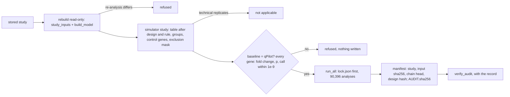
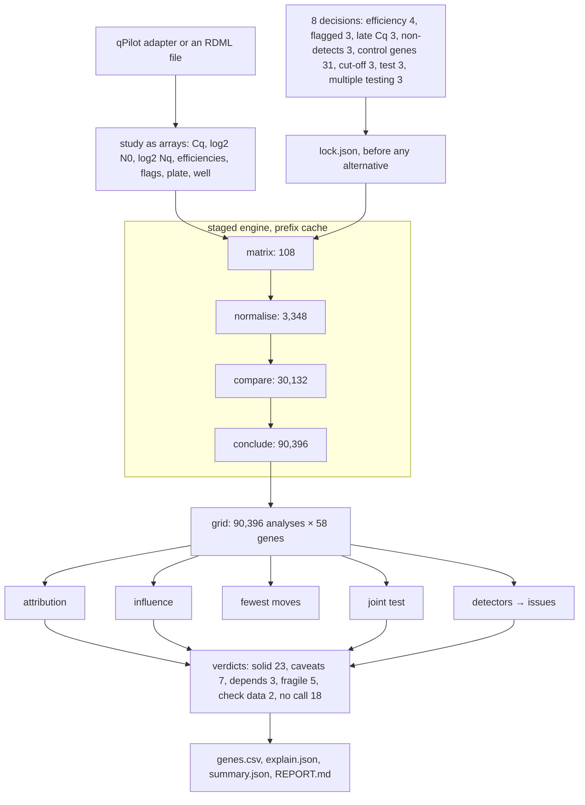

# The qPCR workflow, integrated

`qpilot/integration/` runs every part of qPilot as one pipeline, from the instrument's RDML file to
a verified Analysis Record, and adds the Decision Simulator (`qsim`, vendored in
`sim/` and installed with the `sim` extra) as an audit of the analysis a person confirmed. It changes no existing
module: the engine, Studio, the Prism bridge, the record and the MCP server are used as they are.
Research use only.

```bash
pip install -e ".[dev,ai,studio,xlsx,parquet,sim]"   # sim: the Decision Simulator stage (qsim)
qpilot fetch-demo                                    # once
python -m qpilot.integration demo --out run-demo     # every stage on the demo, checked (~3 min)
python -m qpilot.integration audit --study <id>      # audit a study a person analysed in Studio
python -m qpilot.integration verify <audit> --record <record dir or zip>
qpilot serve --list-tools                            # what the one MCP server serves here
qpilot serve                                        # MCP: qPilot's 11 tools + 5 read-only sim_* tools
```

## The system

```mermaid
flowchart TB
  subgraph outside[" "]
    RDML[qPCR instrument: RDML, raw curves]
    SHEET[sample sheet, optional]
    SCI[scientist: one sentence, every decision]
  end
  subgraph laptop["the scientist's computer: 127.0.0.1 only, runs offline"]
    UI1[Studio page] --> SVC[Studio service: proposals, firewall, checks, Curve Judge]
    UI2[qPilot app] --> ENG
    UI3[simulator screen :8765] --> QSIM
    MCP[MCP server, stdio] --> QSIM
    SVC --> ENG[engine: LinRegPCR, geNorm, Welch, grid, cards]
    SVC --> AI[AI layer: Design Interpreter, Prism draft]
    ENG --> PRISM[Prism bridge, Mode S]
    ENG --> REC[Analysis Record]
    INT[integration: workflow, simulator adapter, sim tools] --> QSIM[qsim: 8 decisions, 90,396 analyses, verdicts]
    ENG --> CACHE[(curve cache)]
    SVC --> STORE[(study store)]
    QSIM --> OUT[(record, Prism bundle, audit)]
    AI -. quoted names only .-> LLM[local model, optional]
  end
  RDML --> UI1
  SHEET --> UI1
  SCI --> UI1
  PRISM -. CSV + run.pzc .-> GP[GraphPad Prism, the scientist's licence]
  GP -. CSV back .-> PRISM
  AGENT[AI agent] <-->|stdio| MCP
  LLM -. opt-in, pseudonymised .-> REMOTE[remote model]
```

## The workflow

| # | Stage | AI or rules propose | Engine computes or checks | Person decides | Written |
|---|---|---|---|---|---|
| 1 | Intake | — | inspect; quarantine 562 names | drops in the file | Studio session |
| 2 | Design, blind | 131 proposals | 121 consistent, 9 contradicted | accepts, rejects with reasons, confirms | `proposals.jsonl` |
| 3 | Curves, blind | Curve Judge: 166 disagreements, 110 that matter | LinRegPCR contradicts each (`D-CURVE`) | keeps LinRegPCR, confirms | the design's call rule |
| 4 | Choices | — | 744 analyses; ODC1 3.590× up; the Excel route changes 14 of 58 | decides each card | `results.json`, `decisions.jsonl` |
| 5 | Simulator | — | 90,396 analyses; baseline = qPilot to 5e-15 | reads verdicts | `simulator_audit/` |
| 6 | Prism | the draft | log2 per unit; provenance | accepts, Send to Prism | CSVs, `run.pzc`, `send_back.pzc` |
| 7 | Round trip | — | ODC1 #1496 missing: 3.590× → 3.319×, 0 of 58 change | gives the reason, decides again | new study, re-audit |
| 8 | Record | — | export, verify, bind the audit | — | Analysis Record |
| 9 | Agents | an agent asks over MCP | `qpcr_decide` → `pending_human` | answers in the app | the request in the chain |

Numbers: the demo run of 18 Oct 2026 (`python -m qpilot.integration demo`), 30 of 30 checks.

Every accept, reject, decision and export goes through a `Person` object with `actor="human"` and
a reason, and is logged in `workflow.json`. `ScriptedPerson` is the policy of
`qpilot studio demo --check`, for checks and demos; in real use the person is the scientist on the
Studio page.

## The simulator adapter



* **Same data.** The simulator gets the per-well table after the confirmed design (well roles,
  exclusions) and the primary amplification rule, the comparison's groups and the candidates.
* **Excluded is not undetermined.** A well a person excluded is left out under every option,
  never filled in by a non-detect rule (`ExcludingEngine`). A well whose quantity an amplification
  rule removed is undetermined in both tools (its Cq is cleared).
* **Two named groups.** The simulator's cut-off decision becomes one option, the design's
  comparison (30,132 analyses).
* **The person's choices** on the Decision Cards are mapped to simulator options and compared
  with the prespecified analysis (`your_choices.csv`): control genes → `refs`, cut-off → `cut`,
  empty wells → `nondetect`, Cq ≤ 35 / 38 → `late_cq`. Cq ≤ 40 and the learned call have no
  counterpart and are named as such.
* **Binding.** The audit sits beside the record, not inside it (`qpilot verify` rejects unlisted
  files). `verify_audit` checks the audit's checksums and lock, and with a record that the record
  verifies, is the same study and input, and contains the audited chain head. After a Prism
  exclusion, the first audit is refused for the new record and the re-audit is accepted.

## The Decision Simulator



## The Prism bridge

```mermaid
sequenceDiagram
  participant P as Person
  participant St as Studio
  participant Pr as Prism
  participant Q as Simulator
  P->>St: Send to Prism
  St->>St: rebuild; refuse if numbers differ
  St->>Pr: one CSV per gene, run.pzc, send_back.pzc, provenance
  P->>Pr: leaves out ODC1 sample 1496
  Pr->>St: send_back.pzc exports the tables as CSV
  St-->>P: "Reason?" ODC1 3.590× → 3.319×, 0 of 58 change
  P->>St: "failed RNA extraction"
  St->>St: new design → new study; cards reopen
  St->>Q: re-audit; reproduces qPilot; 0 verdicts change
```

## Tests

`tests/integration/` (33 tests, about 4 minutes with the demo cached):

* `test_workflow_demo.py`: every stage and check; only the person decides, always with a reason;
  the audit comes after the blind stages, reproduces qPilot, equals the simulator's own published
  verdicts gene for gene, is bound to the bundle and the record, and the stale audit is refused.
* `test_engines_agree.py`: qPilot's grid and the simulator agree on all 558 shared analyses
  (31 control-gene sets × 3 cut-offs × 2 empty-well rules × 3 amplification rules), for every gene,
  before and after the Prism exclusion.
* `test_simulator_adapter.py`: two named groups, technical replicates (not applicable), a
  person's Cq ≤ 35 choice, a refused audit writes nothing.
* `test_mcp_tools.py`: the tools are read-only, serve verified audits only, and return errors as
  data; `sim_findings` pages, filters by gene, and refuses a changed, linked or oversized file.
* `test_mcp_stdio.py`: an agent over a real stdio connection, through `python -m qpilot.integration
  serve` and through `python -m qpilot.mcp_server` (what `qpilot serve` runs).
* `test_audit_files.py` (no demo data): checksums, unlisted and missing files, the missing
  simulator, the empty-folder rule.

## Agents: one MCP server

`qpilot serve` (and `python -m qpilot.mcp_server`, `claude mcp add qpilot -- qpilot serve`) registers
qPilot's eleven `qpcr_*` tools and, when the Decision Simulator (`qsim`) imports, its five read-only
tools: `sim_audit`, `sim_gene`, `sim_decisions`, `sim_whatif` and `sim_findings`. Without `qsim` the
server lists the eleven tools, does not fail, and prints on stderr that the `sim_*` tools are off;
`qpilot serve --list-tools` prints what this install serves. `python -m qpilot.integration serve`
is the same server with the `sim_*` tools always on (the audit readers need only the saved files).

| Tool | What it returns |
|---|---|
| `sim_audit(study_id)` | Verdict counts, scope, the reproduction check, the lock hash and what to lock in advance |
| `sim_gene(study_id, gene)` | One gene's verdict, how often its call holds, what flips it, margins |
| `sim_decisions(study_id)` | The decisions the audit varied: options, tiers, roles, the prespecified baseline |
| `sim_whatif(study_id, changes, genes=None)` | Every gene recomputed under some choices; nothing stored, nothing chosen |
| `sim_findings(study_id, table="issues", gene=None, offset=0, limit=50)` | A page of `issues.json`, `one_sample_flips.csv` or `reference_wells_top50.csv` (`table`: `issues`, `one_sample_flips`, `reference_wells`), with the file's sha256 and `next_offset` |

The `sim_*` tools read only `<study store>/simulator_audits/<study_id>/`, where
`python -m qpilot.integration audit` writes; an agent never names a path. An audit is served only
when it verifies (`AUDIT.sha256`, lock, manifest) and is that study's. `sim_findings` opens only
the three files above, by fixed name, refuses a symlink or anything that resolves outside the audit
folder, refuses a file over 4 MB, and returns at most 200 rows per call.

## Not yet integrated

* The simulator's validation branches (dPCR truth, null plate, efficiency calibration).
* A simulator panel on the Studio page (the page is not changed here).
* Designs with technical replicates (the simulator needs one well per sample and gene).
* `qpilot workflow` in the frozen CLI registry (it runs as `python -m qpilot.integration`).
* Prism on a real seat (plan step 0.1).
