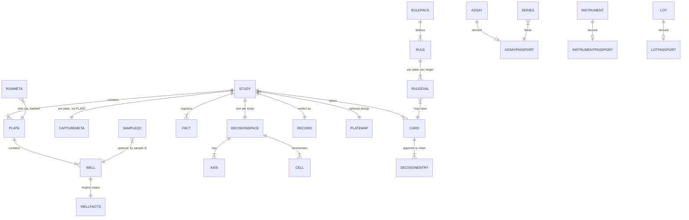
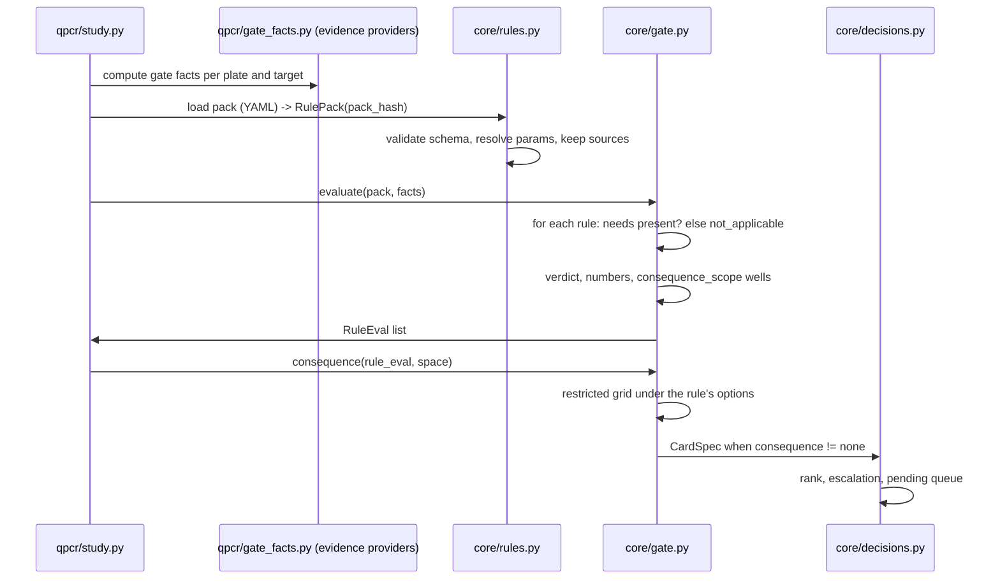
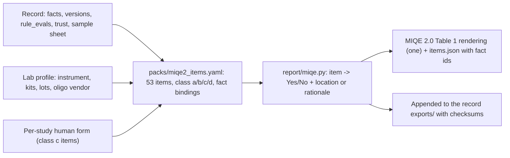

# W3 — qPilot product architecture (build-from document)

Date: 17 October 2026. Audience: the two qPilot developers. Status: architecture for the next six months plus the extension points that the deferred items will need. Scope is **exactly** the surviving thesis of `W2-red-team-review.md` (§3 sequencing, §4 do-not-build list); nothing killed or deferred there is designed here beyond the hook it will plug into. Every number that is not from the running code is cited to the note that reported it; where a figure is an estimate, it says so.

How to read this: §1 principles, §2 system map, §3 data model, §4 engine extension points, §5 Run Gate and Memory, §6 capture and provenance, §7 interfaces, §8 reporting and export, §9 security and trust, §10 quality, §11 roadmap, §12 open questions. Terms are defined once, in the glossary at the end of §2.

---

## 1. Architecture principles

### 1.1 Carried over (the fixed constraints in `00-brief-for-researchers.md`)

| # | Principle | What it means in code today |
|---|---|---|
| P1 | **Open source, Apache-2.0, permissive dependencies only.** No GPL/AGPL/EUPL in the distribution. | `rdmlpython` is vendored (MIT). GPL tools (qpcR, PCRedux, `drc`, Primer3, qslib) are used, at most, as test oracles, never imported. |
| P2 | **Local-first.** Runs on a laptop, works offline, nothing leaves the machine by default. | The app binds to `127.0.0.1`, telemetry is forced off before Gradio imports, an offline test exists (`app.py` docstring). |
| P3 | **Deterministic engine; no model in the maths.** Models only explain, answer questions over engine facts, or draft text that is checked against the engine. Any ML that affects numbers is a validated, versioned method module with a public acceptance test. | `qpcr/study.py` is byte-deterministic; `core/validator.py` rejects any digit not bound to a fact. |
| P4 | **The scientist decides where it matters; the tool never silently changes a conclusion.** Decisions are impact-ranked. | `core/decisions.py` enforces in code: a choice that can flip any conclusion is a human decision for every actor and autonomy level. |
| P5 | **Research use only.** Not clinical, not IVD, not 21 CFR Part 11; regulated practice is borrowed and relabelled. | The vocabulary rules of `W2-run-gate-lab-memory-spec.md` §F.2 apply to every new surface. |
| P6 | **Everything is recorded, re-runnable and agent-callable.** | `core/record.py` (hash-chained, checksummed, `rerun`), `core/store.py` (on-disk workspace with locks), `mcp_server.py`. |
| P7 | **The core is domain-agnostic; qPCR is the first plugin.** `qpilot/core/` never imports `qpilot/qpcr/`. | `core/robustness.py`, `core/decisions.py`, `core/facts.py`, `core/record.py`, `core/store.py`, `core/validator.py`, `core/confidence.py` are already written that way (`rerun` imports the plugin lazily, documented). |

The five things qPilot is to be known for, which this architecture must protect (`W2-red-team-review.md`, short version): local, unlimited, open method with published per-well efficiency, robustness across choices, hash-chained record, agent-callable.

### 1.2 Added by the surviving discoveries

| # | Principle | Why (source) | Consequence for the design |
|---|---|---|---|
| P8 | **Memory is derived, never authoritative.** Passports, Series, control-chart limits and alias tables are pure functions of the records and side-cars; `memory build --rebuild` must reproduce them byte for byte. | Spec §A.6 step 5 and §E.2 (determinism acceptance test); red team §2.4 (cold start). | SQLite/parquet under `labmemory/` is a cache. The only hand-typed inputs are the side-cars (`run_meta/*.yaml`, `lots.jsonl`, alias tables, lab profile), and those are hashed into every record that used them. |
| P9 | **Every rule is a sourced, overridable pack; a rule never refuses a number, it labels it.** | Red team §2.6 (the claim floor is one group's proposal: ship as `bustin2025-tiers`, overridable, applied only when precision is not demonstrated, never a refusal); spec §B.0 (thresholds are "examples with sources", lab-editable, every edit is a new pack version and an Event). | A rule-pack loader in core; packs are YAML with `sources`, `params`, `severity`, `consequence_scope`; the pack hash is in the record; `not_applicable` is a first-class verdict, never silently `pass`. |
| P10 | **Capture proves rawness.** The engine's input is raw, un-baselined fluorescence; the import layer must test for it and the record must say what it found. | `05-instruments-formats-standards.md` D1 (CFX RFU sheets inherit the active baseline mode [9]; LC480 text is scaled [48-ixo]; the LinRegPCR authors require un-baselined data [34]); `06` D1 merged into it (red team cluster A). | Import Trust Card per plate; `G-PROV` gates every per-well-efficiency rule; Study Confidence capped when curves are processed or absent (Cq-only mode). |
| P11 | **Honest numbers on every cell.** The robustness grid gains labels (claim floor, prediction interval, censoring share, "what is your n") rather than more p-values. | `W2-prototype-study-model.md` §8 (what the data showed); red team §3.1. | New axes and post-hoc labels are added to the grid through the `DecisionSpace` protocol; labels never change a conclusion, they qualify it. |
| P12 | **Gate first, Memory later; "provisional" everywhere until the data exist.** | Red team §2.4, §3.3 (Gate v0 works on plate 1; Memory from month 4; robust median/MAD limits by default because first-20 limits were poisoned by one outlier in `W2-prototype-plate-artefacts.md` §5). | Within-study trending ships with the Gate; cross-study Series only when a workspace has ≥10 runs for a Series; status words are `provisional / in_control / warning / rejection`. |
| P13 | **Untrusted content stays data.** Instrument exports carry free text that may be instructions; it is quarantined with a text id and shown to a model only as quoted data. | `13-ai-agents-autonomous-labs.md` D4; red team §3.5. | A firewall pass at the `io` boundary; manifest pinning; an egress ledger in the record. |
| P14 | **The cheap half of any protocol, never the protocol rebuild.** | Red team §2.5 (MCP Tasks moved twice in eight months; no host support). | Annotations, `outputSchema`, typed refusals, idempotency keys, concise mode, `resource_link`; keep the blocking path. |
| P15 | **A new domain is a plugin, and a domain plugin is built only after the expression core is stable; shared maths goes into a substrate, not a domain.** | Red team §2.1 and §4 item 3 (the eDNA LOD/LOQ maths becomes the generic standard-series substrate; telomere is the first real pack, conditional on a partner; dPCR is a second data kind in year 2). | `qpilot/qpcr/standards.py` is generic; `qpilot/plugins/<domain>/` is the shape for later packs; `qpilot/dpcr/` is reserved. |
| P16 | **No feature needs a partner lab's archive to be useful on day one; features that do are labelled as such in the roadmap.** | Red team §2.4, §5 facts 5–7. | Roadmap §11 marks every increment that needs multi-run partner data. |

---

## 2. System map

### 2.1 Layers

```mermaid
flowchart LR
  subgraph CAP["Capture (qpilot/io)"]
    C1["Connectors: RDML, QuantStudio TXT, CFX CSV, openreadout (optional), Thermo CLI wrapper"]
    C2["RDML dialect normaliser: qpilot rdml inspect"]
    C3["Raw-ness detector + Import Trust Card"]
    C4["Free-text quarantine (firewall)"]
    C5["Plate-map verify: design vs as-run"]
  end
  subgraph NORM["Normalise (qpilot/qpcr)"]
    N1["curves.py: LinRegPCR per well, tidy table"]
    N2["melt.py: MCA peaks per well"]
    N3["Typed controls + alias tables"]
  end
  subgraph ENG["Engine (qpilot/qpcr)"]
    E1["quant.py, refgenes.py, contrast.py"]
    E2["axes/: efficiency, non-detect, aggregation, inter-plate (later)"]
    E3["labels: claim floor, prediction intervals, n-guard"]
    E4["standards.py: standard-series substrate"]
    E5["space.py: QpcrSpace implements DecisionSpace"]
  end
  subgraph CORE["Decision Space + Cards + Record (qpilot/core)"]
    K1["robustness.py: grid, holds, impact, fragility"]
    K2["decisions.py: cards, escalation, pending queue"]
    K3["rules.py + gate.py: rule packs, RuleEval, consequence test"]
    K4["facts.py + validator.py: no naked numbers"]
    K5["record.py + store.py: hash chain, checksums, locks"]
    K6["confidence.py: GRADE-style levels"]
  end
  subgraph MEM["Memory (qpilot/core/memory, derived)"]
    M1["Series, robust limits, Westgard"]
    M2["Passports: assay, instrument, lot, control material"]
    M3["labmemory.sqlite + curves parquet"]
  end
  subgraph REP["Report / Export (qpilot/report)"]
    R1["MIQE 2.0 Table 1 + JSON"]
    R2["Reviewer's Report"]
    R3["SuperPlot figures + source CSV"]
    R4["RO-Crate .eln, Zenodo, study.qpilot pack"]
    R5["Excel/CSV, tidy parquet"]
  end
  subgraph IF["Interfaces"]
    I1["CLI"]
    I2["Gradio app"]
    I3["MCP server + SKILL.md"]
    I4["Watched folder + notify"]
    I5["Library API (qpilot.api) + qpilotr"]
  end
  CAP --> NORM --> ENG --> CORE
  CORE --> MEM
  MEM -. "passport facts, learned limits" .-> ENG
  CORE --> REP
  IF --> CAP
  IF --> CORE
  IF --> REP
  IF --> MEM
```



Plain-text explanation, left to right:

1. **Capture** turns whatever the lab has into an RDML document plus a `CaptureMeta` (recipe id, source hash, dialect label, layers present, raw-ness verdict, quarantined text). It is the only code that opens an outside file (`io/README.md` rule). It produces the Import Trust Card and, when a design exists, the design-vs-as-run diff.
2. **Normalise** runs LinRegPCR on every plate with one setting (`qpcr/curves.py` already does this and parses by header name), runs melt-curve analysis, and attaches the typed controls (sample types from RDML, vendor task names mapped, or the "type your controls" prompt remembered per layout).
3. **Engine** builds relative quantities, geNorm and the per-gene contrasts under one set of choices, and exposes the full set of choices as a `DecisionSpace` (`qpcr/space.py`). New here: the extra axes, the post-hoc labels, and the standard-series substrate.
4. **Core** sweeps the space (`core/robustness.py`), builds and ranks cards (`core/decisions.py`), evaluates rule packs and the consequence test (new `core/rules.py`, `core/gate.py`), registers facts, grades confidence, and writes the record through the store. It never imports `qpcr`.
5. **Memory** is a derived store rebuilt from records and side-cars; it feeds learned limits and passport facts back to the engine as *inputs* (never as authority) and is absent, by design, until a workspace has the runs to justify it.
6. **Report/Export** renders the record: MIQE 2.0 items, the Reviewer's Report, fact-bound figures, deposition bundles, tidy tables.
7. **Interfaces** are thin: CLI, Gradio, MCP, the watched-folder daemon and the library API all go through the same store and the same tool functions (`ai/ask.py` already runs MCP tool code in-process).

### 2.2 Component inventory: exists / changes / new; core vs plugin

| Component | Package | Status | Core or plugin | Notes |
|---|---|---|---|---|
| Hardened RDML loader, `CONNECTORS` registry | `io/rdml_io.py` | exists | io | Extended: a connector returns `(doc, CaptureMeta)`; `.rdml/.xml` today. |
| QuantStudio TXT and CFX CSV connectors | `io/connectors/` | **new** | io | Documented exports (`05` §1.4). Own code, header-name parsing. |
| `openreadout` reader | `io/connectors/openreadout.py` | **new** | io, optional extra | MIT OR Apache-2.0 wheel, v0.3.0, 13 Oct 2026, reads `.eds/.ixo/.rex/.lc96p`, refuses `.pcrd` (`05` [48]). Pinned; fixtures contributed upstream (red team cluster A). |
| Thermo D&A CLI wrapper | `io/connectors/thermo_cli.py` | **new** | io | Wraps `cmdlineutil.exe -export … -x rdml` (`05` §1.4 [1]); existence in D&A 2.x unverified (`05` §5; red team §5). |
| RDML dialect normaliser (`qpilot rdml inspect`) | `io/inspect.py` | **new** | io | Dialect label, layer presence, fix plan (`05` D2). |
| Raw-ness detector + Import Trust Card | `io/rawness.py`, `qpcr/trust.py` | **new** | detector = qpcr method module; card = core card kind | Tests from `06` D1 as merged by the red team. |
| Free-text quarantine | `core/firewall.py` applied in `io` | **new** | core | `13` D4. |
| Plate-map verify | `io/platemap.py` | **new** | io | Verify only; writers deferred except QuantStudio TXT/CFX import "maybe" (red team §4 item 5). |
| LinRegPCR per well, tidy table, cache | `qpcr/curves.py` | exists | plugin | Unchanged; the tidy columns become the frozen library schema (§7.2). |
| Melt-curve analysis | `qpcr/melt.py` | **new** | plugin | rdmlpython MCA wrapper; peaks per well (spec §A.3). |
| Relative quantities, geNorm, group effect, Welch | `qpcr/quant.py`, `refgenes.py`, `contrast.py` | exist | plugin | `refgenes.group_effect` becomes the headline (red team §2.3). |
| Co-regulation screen, "algorithms disagree" card | `qpcr/refgenes.py` | **change** | plugin | `07` D7 KEEP part. |
| Efficiency-model axis + delta-method variance | `qpcr/axes/efficiency.py` | **new** | plugin | Prototype `s4`. |
| Non-detect axis (drop / substitute floor / censored MLE) | `qpcr/axes/nondetect.py` | **new** | plugin | Prototype `s3`; replaces `cap`. |
| Aggregation axis (technical replicates) | `qpcr/axes/aggregation.py` | **new** | plugin | Only active when technical replicates exist (the demo has none). |
| Inter-plate axis (none / IRC / Ruijter factor) | `qpcr/axes/interplate.py` | **new, after month 6** | plugin | Cannot be validated on Vermeulen (`W2-prototype-plate-artefacts.md` §4). Hook designed now. |
| Claim-floor label, prediction intervals, n-guard | `qpcr/labels.py` | **new** | plugin | Prototype `s5`, `s6`; `07` D5 guard. |
| Standard-series substrate | `qpcr/standards.py` | **new** | plugin (generic within qPCR) | Detection table, log-dose fits, LOD/LOQ, outlier-standard cards (bake-off §5.1 step 1; red team §2.1). |
| Decision space | `qpcr/space.py` | **change** | plugin | Gains axes through a registry; lazy evaluation (§4). |
| Study runner | `qpcr/study.py` | **change** | plugin | Wires axes, labels, gate facts. |
| Grid, cards, facts, validator, record, store, confidence | `core/*` | exist | core | Record gains fields (§3.6); store gains `rule_evals.json`, `trust.json`, `gate.json`. |
| Rule-pack loader and evaluator | `core/rules.py` | **new** | core | YAML packs; pack hash; `not_applicable`. |
| Generic gate + consequence test | `core/gate.py` | **new** | core | Runs the restricted grid under a rule's options. |
| Pending queue, escalation | `core/decisions.py`, `core/store.py` | exist | core | Idempotency key and `traceparent` added to `DecisionEntry` (§7.3). |
| Memory store, Series, Westgard, passports | `core/memory/` | **new, month 4+** | core (generic tables) with qpcr metrics | Spec §A, §B.2; robust limits default. |
| Identity and alias tables | `core/identity.py` | **new** | core | `assay_id`, `instrument_id`, `control_id` rules (spec §A.2). |
| MIQE 2.0 item map + renderer | `report/miqe.py`, `packs/miqe2_items.yaml` | **new** | renderer core; item map plugin data | `14` D1, one rendering. |
| Reviewer's Report | `report/review.py`, `packs/review-rules.yaml` | **new** | plugin data, core renderer | `14` D2. |
| SuperPlot figures | `report/figures.py` | **new** | plugin | `14` D3. |
| RO-Crate `.eln`, Zenodo, `study.qpilot` pack/verify | `report/deposit.py`, `core/pack.py` | **new** | core | `14` D4 reshaped; `16` D5; `03` D5 `.eln` part. |
| Excel/CSV export, tidy parquet | `report/tables.py` | exists → **change** | core | Frozen tidy schema (§7.2). |
| Explanation templates, model layer, harness | `explain/`, `ai/`, `harness/` | exist | core-ish | Harness gains F3/F4 items. |
| CLI | `cli/` | **change** | — | Command tree §7.1. |
| Gradio app | `app.py`, `app_state.py` | **change** | — | Pages §7.6. |
| MCP server | `mcp_server.py` | **change** | — | §7.3. |
| Watched folder + notify | `daemon/watch.py`, `daemon/notify.py` | **new, last increment** | — | `16` D2. |
| Library API | `qpilot/api.py` | **new** | — | §7.2. |
| `qpilot doctor`, `qpilot qualify` | `cli/` | exists / **new** | — | `16` D1, D4. |
| Trust Pack generator | CI + `trust/` | **new** | — | `16` D3. |
| dPCR plugin | `qpilot/dpcr/` | reserved (year 2) | plugin | Only the package boundary is fixed now. |
| Domain packs (telomere first, conditional) | `qpilot/plugins/<name>/` | reserved | plugin | Shape only (§4.5). |

### 2.3 Glossary (defined once)

- **RDML** — the XML interchange format (`experiment → run → react → data`, per-cycle `adp`, melt `mdp`); 1.3 is the recommendation, 1.4 a candidate (spec §0 [47]).
- **Sample type** — the RDML enumeration `unkn, ntc, nac, std, ntp, nrt, pos, opt`; `ref`/`toi` are *target* types (spec §0).
- **Cq, N0, E** — quantification cycle; starting quantity `N0 = Nq / E^Cq`; per-cycle efficiency (2.0 = 100 %) (spec §0).
- **LinRegPCR** — the per-well baseline/efficiency method run via vendored `rdmlpython` (MIT).
- **Study, plate (run), well** — a study is one input file (today) or an assembled set of plates (after capture); a plate is an RDML `run`; a well is a `react`.
- **Fact** — a number or label with an id (`f_…`), format, unit and source path (`core/facts.py`); prose may only show numbers through fact tokens.
- **Decision Space, cell, axis** — the set of reasonable analyses; a cell is one combination of options; an axis is one dimension (`core/robustness.py`).
- **Decision Card** — a choice that could change a conclusion: evidence, options, per-item consequences, recommendation, logged reason (`schemas.DecisionCard`).
- **Escalation rule** — a choice that can flip any conclusion is a human decision for every actor (`core/decisions.py`).
- **Analysis Record** — the folder/zip that lets anyone check and re-run an analysis (`core/record.py`).
- **Gate, rule pack, RuleEval** — rules evaluated per plate and target from a YAML pack; the stored result of one evaluation (spec §A.1, §B.0).
- **Series, passport, Memory** — a per-metric time series over runs; a versioned derived summary of an assay, instrument, lot or control material; the derived store that holds them (spec §A).
- **Capture recipe, Import Trust Card** — the documented export path per vendor and software version; the per-plate card stating what was captured and whether it is raw (`05` D1).
- **Standard-series substrate** — the generic maths over typed `std` wells: detection per standard, log-dose fits, LOD/LOQ, effective LOD for n replicates (bake-off §5.1).

---

## 3. Data model

### 3.1 Domain objects and relationships



| Object | Key | Built from | Lives in (§3.3) | Today |
|---|---|---|---|---|
| `Study` | `study_id = input_sha256` (single file) or `sha256` of the sorted plate `run_hash` list (assembled) | capture | store workspace `$QPILOT_STUDIES_DIR/<study_id>/` | `StudyResult.input_sha256` exists |
| `Plate` (RDML `run`) | `run_hash` = SHA-256 of the canonicalised run element (sorted attributes, per-cycle floats rounded to 6 significant digits) (spec §A.1) | RDML | RDML + `plates.json` in the record | implicit (`run_id` column) |
| `Well` | (`run_hash`, `react.id`, `target_id`) | RDML `react/data` | RDML | tidy table rows |
| `WellFacts` | Well + `engine_version` | LinRegPCR, MCA | tidy table (`curves` cache, parquet in Memory) | `qpcr/curves.py` columns |
| `CaptureMeta` | `plate` | connector + detector | `trust.json` (record) | **new** |
| `TypedLayout` | `layout_hash` = SHA-256 of (well → sample type, target role) | RDML or prompt | RDML `sample/type` written back; `layouts/<layout_hash>.yaml` in the lab profile for "remembered per layout" | **new** |
| `PlateMap` (design) | `design_hash` | `qpilot plan` or CSV | RDML without `<data>` + `platemap.json` side-car (`03` D1) | **new (verify half)** |
| `DecisionSpace` / `Axis` / `Cell` | axis name; cell = dict axis → option | plugin | `grid.csv` (record) lists every evaluated cell | exists |
| `Fact` | `f_<metric>_<slug>_<context>` | engine | `facts.json` | exists |
| `Card` | `card_id` | core | `cards.json` | exists; gains `rule_ids`, `consequence`, `scope` |
| `DecisionEntry` | `seq`, `hash` | store | `decisions.jsonl`, `pending.jsonl` | exists; gains optional `idempotency_key`, `traceparent`, `kind` |
| `RulePack` / `Rule` / `RuleEval` | `pack_hash`; `rule_id`; (`pack_hash`, `rule_id`, `run_hash`, `target_id`) | YAML, core | `packs/*.yaml` (shipped), `labmemory/rule_packs/` (lab edits), `rule_evals.json` (record) | **new** |
| `Assay` | `assay_id` (§3.4) | RDML `target` + registry side-file | alias table in lab profile; passport in Memory | **new** |
| `Instrument`, `ControlMaterial`, `LotRecord`, `Event` | `instrument_id`, `control_id`, `lot_id`, `event_id` | side-cars, lab profile | `labmemory/` | **new, month 4+** |
| `Series` | (`metric`, `assay_id`, `control_id`, `instrument_id`) | WellFacts over runs | `labmemory.sqlite` | within-study version ships with Gate v0 |
| `Passport` | (`kind`, `key`, `version`), `passport_hash` | pure function of the store | `labmemory/passports/<kind>/<key>/<version>.json`; `passport_refs` in the record | **new, month 4+** |
| `RunMeta` side-car | `run_hash` | 10-field prompt or CSV | `labmemory/run_meta/<run_hash>.yaml`; `side_car_hash` in the record | **new, month 4+** |
| `SampleQC` | (`sample_id`, source file hash) | a `rin` column on the sample sheet first; parsers deferred | sample sheet CSV hashed into the record | **new (column only)** |
| `QC exports` (figures, MIQE, review, deposit) | file hash | report layer | record `exports/` + `CHECKSUMS.sha256` | partly exists (Excel/CSV) |

### 3.2 DecisionSpace axes (the full set this architecture anticipates)

| Axis | Options | Status | Source |
|---|---|---|---|
| `refs` | every non-empty subset of candidate reference genes | exists (31 of 5) | `qpcr/space.py` |
| `cut` | group cut-offs (demo: top 10/15/20 % by marker) | exists | `qpcr/space.py` |
| `nondetect` | `drop`, `substitute_floor`, `censored_mle` (replaces `undetermined ∈ {drop, cap}`; `cap` and plate-ceiling substitution were numerically identical on the demo, `W2-prototype-study-model.md` §3) | new, weeks 1–3 | prototype `s3`; `12` D4 |
| `efficiency` | `per_assay_mean` (current), `per_well`, `per_plate_mean`, `assumed_2.0`, `dilution_series` (only when `std` wells exist) | new, weeks 1–3 | prototype `s4`; `07` D1 |
| `aggregation` | `geomean_technical` (default), `kod_then_geomean` (drop kinetic outliers first) | new, with Gate v0; inactive when no technical replicates | spec §B.1 G-REP; `04` D2 KOD part |
| `interplate` | `none`, `irc` (Hellemans), `factor` (Ruijter 2015) | hook now; implementation after month 6 with a multi-gene-per-plate dataset | `03` D3; `06` D4; prototype plate artefacts §4 |
| `plate_model` | `none`, `random_intercept` | **not built** (red team §4 item 1); reserved name | prototype §2 |
| `standards_model` | model family for LOD fits (Weibull I/II, asymptotic regression, log-logistic, Michaelis–Menten) | with the substrate (after month 6 unless a standards-heavy study needs it earlier) | bake-off §5.1 |

Post-hoc **labels** on every cell (not axes): `claim_floor` (tier, pass/below, precision demonstrated?), `prediction_interval` per group, `censored_share` per group, `n_biological` per group with the "<2 biological units → no p-value" refusal, `efficiency_se_widening`. Labels never change `conclude()`.

### 3.3 What lives where

| Store | Content | Authority | Format |
|---|---|---|---|
| **RDML** (input, byte for byte, in the record) | curves, melt, sample types, quantities, targets | authoritative input | RDML 1.3 (written), 1.4 CR on request (`05` D2) |
| **RDML written by qPilot** (`results.rdml` in the record) | per-well `N0`, `ampEff`, `ampEffSE`, `excl`, `note`; `target` expected values from the passport (`amplificationEfficiency`, `…SE`, `…Method`, `meltingTemperature`, `detectionLimit`); `sample/annotation` pairs under the `qpilot:` namespace (`qpilot:lot.master_mix`, `qpilot:control_id`, `qpilot:instrument_id`, `qpilot:spike_copies`, `qpilot:text_id`) | derived (re-runnable) | legal RDML today (spec §A.5) |
| **Side-cars** (`labmemory/run_meta/<run_hash>.yaml`, `lots.jsonl`, `assays.yaml`, `layouts/`, `qpilot_profile.yaml`) | lots, instrument alias, operator, plate barcode, control-material mapping, assay registry fields, remembered typed layouts, lab conventions | authoritative, hand-typed, hashed into every record that used them | YAML/JSONL (`ai/profile.py` already loads the profile with `yaml.safe_load`) |
| **Record folder/zip** | `input.rdml`, `results.json`, `cards.json`, `facts.json`, `grid.csv`, `decisions.jsonl`, `pending.jsonl`, `design.json`, `choices.json`, `versions.json`, `record.json`, `CHECKSUMS.sha256` (all exist) **plus** `trust.json`, `rule_evals.json`, `gate.json`, `passport_refs.json`, `quarantine.json`, `egress.json`, `exports/` | authoritative output | JSON/CSV; `record_id = sha256(CHECKSUMS.sha256)` |
| **Workspace** (`$QPILOT_STUDIES_DIR/<study_id>/`) | the same files, written atomically under `.lock` | working copy | `core/store.py` |
| **Memory** (`labmemory/labmemory.sqlite`, `labmemory/curves/<run_hash>.parquet`, `passports/`) | runs, wells, well_facts, assays, aliases, instruments, control materials, lots, run_lots, events, series, series_points, rule_packs, rule_evals, cards, decisions, passports, manifest (spec §A.7) | **derived; rebuildable** | SQLite (read-only connection for MCP), parquet |
| **Lab profile** | tone, conventions, autonomy policy, instrument aliases, price profile (later) | authoritative | YAML (`qpilot_profile.example.yaml` exists) |

### 3.4 Identity rules

| Thing | Rule | Fallback and what it triggers |
|---|---|---|
| Input file | `sha256` of the bytes (`core/store.sha256_file`) | — |
| Study | single file: `input_sha256`; assembled: `sha256(join(sorted(run_hash)))` | — |
| Plate | `run_hash` (canonicalised run, floats at 6 significant digits) (spec §A.1) | a vendor re-export of the same run with different processing hashes differently and gets a provenance note (spec §A.6 step 1) |
| Assay | `"seq:" + sha256(upper(fwd) + "\|" + upper(rev) + "\|" + upper(probe1 or "") + "\|" + upper(probe2 or ""))` when `target/sequences` is present; else `"com:" + company + ":" + orderNumber` from `commercialAssay` (context-sequence hash when the vendor withholds primers); else `"name:" + target.id` (spec §A.2) | `name:` ids raise a one-time reconciliation card ("`GAPDH`, `Gapdh_2`, `GAPDH-new` appear in 14 runs; same assay?") whose answer is the alias table; the registry prompt asks for sequences once per new name |
| Instrument | lab profile maps the free-text `run/instrument` string to `instrument_id`; serials never leave the machine (spec §A.2) | first unmapped string → card |
| Control material | (`sample name`, `assay`, alias table) → `control_id` | unmapped → the chart shows "unmapped control", never a guess |
| Lot | only from the side-car; date ranges allow back-fill flagged `lot_source = inferred_from_dates` | — |
| Rule pack | `pack_hash = sha256(canonical YAML)`; an edit is a new version plus a `rule_pack_change` Event | — |
| Passport | (`kind`, `key`, `version`), `passport_hash` of the JSON; written into every record that used it | — |
| Typed layout | `layout_hash` of the well → (sample type, role) map | a plate with the same `layout_hash` inherits the remembered typing (red team cluster B: the first Gate experience is the prompt, not a wall of `not_applicable`) |
| Quarantined text | `text_id = "t_" + sha256(field path + value)[:12]` | — |

### 3.5 Record schema evolution (versioned, backwards-readable, chain preserved)

Rules, in order of precedence:

1. **The hash rule never changes.** `DecisionEntry.hash = sha256(canonical JSON of the entry minus hash)` with `prev_hash` of the previous entry (first entry: the input file's sha256) (`core/store.py`). Canonical JSON = sorted keys, UTF-8, no whitespace, as `core/store.canonical_json` does today. A verifier of any version hashes *all* fields present minus `hash`, so an entry written by a newer version with extra fields (`idempotency_key`, `traceparent`, `rule_ids`, `kind`) verifies under an older verifier that ignores unknown keys for semantics but includes them in the hash. Acceptance test: records written by 0.1.0 verify under every later release, and vice versa for the chain.
2. **`decisions.jsonl` and `pending.jsonl` are append-only forever.** Migrations never rewrite them. A migration writes `migrations.json` (from version, to version, files touched) and appends nothing to the chain; the chain head is unchanged by migration.
3. **Every JSON file carries `schema_version` (semver).** Minor bumps are additive (new optional fields with defaults); readers accept any older minor. Major bumps keep a reader for the previous major for at least one year (`versions.json` already records qpilot, python, platform, git and vendored-method commits).
4. **New record files are additive.** `trust.json`, `rule_evals.json`, `gate.json`, `passport_refs.json`, `quarantine.json`, `egress.json` are new files, listed in `CHECKSUMS.sha256`. An older `verify` that does not know them still verifies the checksums (it iterates the checksum file, not a fixed list).
5. **`rerun` is versioned by method, not by app.** `rerun_matches` compares against the engine version named in `versions.json`; a later engine may produce different numbers and must say "re-run under engine X differs from the recorded engine Y" rather than "tamper". Determinism is a claim about the same versions.
6. **Facts are stable by id.** A fact id's meaning may not change within a major; a renamed metric gets a new id and the old one is kept with a `deprecated_by` field for one major.
7. **Pack and passport references are by hash, so a record is interpretable without Memory.** `rule_evals.json` embeds the rule statement, params and sources used, not just the id.

### 3.6 Record additions (fields)

| File | New content | Source |
|---|---|---|
| `trust.json` | per plate: `recipe_id`, `source_sha256`, `dialect`, `layers {adp, mdp, cq, n0, ampEff}`, `rawness {verdict, tests: [{id, value, threshold}]}`, chosen option, `study_confidence_cap` | `05` D1, D2 |
| `rule_evals.json` | `rule_pack {name, version, hash}`; per plate per rule: `{rule_id, verdict ∈ pass\|warn\|fail\|not_applicable, numbers, scope_well_ids, not_applicable_reason, sources}` | spec §D.2 |
| `gate.json` | per plate per target the one-line summary; per card: `consequence {class, per_item_calls_by_option, grid_agreement}`, `recommendation` | spec §D.1, §C.2 |
| `passport_refs.json` | `[{kind, key, version, hash}]`, `side_car_hash` | spec §D.2 |
| `quarantine.json` | `[{text_id, field_path, value}]` | `13` D4 |
| `egress.json` | every outbound call (default: none) with destination class and payload hash | `13` D4; `16` D2 (notification events) |
| `choices.json` | gains `axes` (which axes were swept fully, which screened), `labels` (claim-floor pack hash) | §4.2 |
| `decisions.jsonl` entries | optional `idempotency_key`, `traceparent`, `kind ∈ card\|gate\|alias\|lot\|export`, `rule_ids` | §7.3 |

---

## 4. Engine extension points

### 4.1 The contract (unchanged) and how an axis is added

`schemas.DecisionSpace` stays as it is: `dimensions`, `primary`, `items`, `evaluate(cell) → dict[item, ContrastResult]`, `conclude(result)`. The core sweeps `itertools.product` over `dimensions` (`core/robustness.cells`). An axis is therefore *data the plugin adds to `dimensions`* plus *a transform the plugin applies inside `evaluate`*. Nothing in core changes to add an axis.

In the plugin, an axis is a small object:

```python
class Axis(Protocol):
    name: str  # "efficiency"
    options: list[Any]  # ["per_assay_mean", "per_well", ...]
    primary: Any
    stage: Literal["matrix", "normaliser", "groups", "test"]

    def applies(self, study) -> bool: ...  # e.g. aggregation needs technical replicates
    def apply(self, state, option) -> state: ...  # pure; cached by (stage, option)
    def card_spec(self, impact) -> CardSpec | None: ...

    method_card: MethodCard  # paper, version, acceptance test id
```

`QpcrSpace` composes axes in stage order: **matrix** (efficiency rebuilds `log2 N0` from Cq via `N0 = Nq / E^Cq`, which holds exactly because Nq is constant per plate, CV 0.07 % on the demo; `W2-prototype-study-model.md` §0) → **aggregation** (technical replicates → biological units) → **nondetect** (imputation or censoring marks) → **normaliser** (`refs` subset; mean of reference columns, cached per subset as `_ref_mean` is today) → **groups** (`cut`; masks cached) → **test** (vectorised Welch; Tobit only for items with censoring marks). `interplate` is a matrix-stage transform that needs cross-plate overlap and refuses (returns `not_applicable` and holds at `none`) when the design is confounded, as the prototype found for one-gene-per-plate designs.

### 4.2 Keeping the cell count under control

Measured: the current 186-cell sweep over 58 genes takes 0.07 s (red team cluster B, memory note). The prototype estimated ~750–930 cells with the efficiency axis (`W2-prototype-study-model.md` §8 item 2). With `nondetect` at three options the product is 31 × 3 × 3 × 5 = 1,395 cells; with `interplate` at three it is 4,185. Assuming linear scaling (an estimate, to be measured), that is on the order of a second or a few seconds for the vectorised path. The expensive part is the censored MLE (`scipy.optimize.minimize` plus a numerical Hessian per censored gene per cell). Four mechanisms, all recorded in `choices.json → axes`:

1. **Stage caching.** Each stage's output is memoised by the tuple of options up to that stage, so the five efficiency matrices are built once, the 31 normaliser means once per matrix, and so on. Memory: 5 matrices × 3 nondetect variants of a 366 × 64 float64 matrix is trivial.
2. **Vectorisation across items and across the `refs` axis.** The Welch stage already runs over all genes at once; the normaliser stage can run all 31 subsets as one `(31, samples, genes)` broadcast when memory allows (a flag; default on below 10 M floats).
3. **Censored MLE only where it can matter.** Tobit runs only for items with ≥ 1 censored value in the cell (19 of 58 genes on the demo); other items return the Welch result unchanged (the prototype's singular-Hessian guard: 5 of 58 fits failed on uncensored genes, and the fallback SE is Welch's).
4. **Screening sweep and adaptive product.** Before the full product, the core varies each axis alone from the primary cell (this is already how `impact_per_dimension` works). An axis that flips no item and moves no `log2fc` beyond a threshold (default 0.5 log2, the prototype's own reporting threshold) is **screened out** of the product and held at its primary; it still appears in `impact` and in the record as `screened: no change`. The full product runs over the remaining axes. The `holds` fraction is then defined over the swept product and the record says which axes it covers. A hard cap (`max_cells`, default 5,000) turns on sampling of the product with a fixed seed when exceeded, recorded as such; the default settings should never hit it on a 3-vs-3 study.

The screening rule is a design choice (§12 Q3); its default is conservative because an axis that moves nothing alone can still interact, which the record makes visible by listing it as screened.

### 4.3 Post-hoc labels

Labels are computed once per cell from the cell's `ContrastResult` and per-group summaries, by `qpcr/labels.py`, and attached as `ContrastResult.labels: dict[str, Any]` (an additive, optional field, §3.5 rule 3):

- **Claim floor** (`bustin2025-tiers` pack): tiers 2×/3×/4× by the *less precise group's* mean Cq, applied only when the cell's own CI does not already demonstrate the precision; label = `below_floor_precision_not_demonstrated` or `passes_floor` or `floor_not_applicable (precision demonstrated)`; when the lab has standards or technical replicates, the lab's own floor from its replicate SD replaces the tiers (red team §2.6 items 1–4). The pack cites Bustin, Kirvell, Nolan, Mueller, Shipley, *Int J Mol Sci* 2025;26:7796 and states it is not MIQE 2.0. Acceptance: re-run `s5_claimfloor.py` with the precision clause; the red team expects the 23/40 count to fall well under 10 (a prediction, to be measured).
- **Prediction interval** per group: `mean ± t_{0.975,n−1}·s·√(1+1/n)` on the normalised log2 scale; one sentence template (prototype §6: ODC1 3.6× on average, CI 2.4–5.3×, but a single new tumour spans a 290-fold range).
- **Censored share** per group and the >30 % sensitivity card (Pipelers rule as cited by the prototype §3).
- **n-guard**: biological units per group from the sample sheet; `<2` → the p-value is withheld and the card asks "are A1–A3 one cDNA or three animals?" (`07` D5; red team §3.1).
- **Efficiency-SE widening**: delta-method variance `Var_E(D) = Σ_k w_k² (ΔCq_k/(E_k ln2))² Var(E_k)` added before the t (prototype §8 item 3); shipped, not promised: zero effect at n = 366 wells, matters at n ≤ 12.

### 4.4 Rule packs: how they run



- `core/rules.py`: loads YAML (`yaml.safe_load`), validates against a JSON schema shipped in `packs/schema.json`, computes `pack_hash`, exposes `Rule.needs`, `params`, `severity`, `consequence_scope`, `default_action`, `sources`, `statement`. It knows nothing about qPCR: `needs` are fact ids, `keys_on` are strings.
- The plugin registers **evidence providers**: functions that compute the named facts (`engine_call`, `lowest_unknown_cq`, `melt_class`, `gdna_fraction`, `replicate_range`, `poisson_tolerance`, `kod_z`, `e_std_gap`, `rawness_verdict`, …). A rule whose `needs` are missing returns `not_applicable` with the reason (spec §B.0: never `pass`).
- `core/gate.py` turns a failed rule into options (`keep / exclude tainted wells / …`, spec §C.2), runs the **consequence test** by evaluating the existing space restricted to the rule's `consequence_scope` under each option, and classifies the result `none / magnitude / flip / unknown`. It reuses `core/robustness` (the red team's condition for the two-week Gate v0 estimate).
- `default_action: invalidate_plate` exists in the schema but no shipped pack in year one uses it; it is always Human-only (spec §B.0, §D.4).
- Lab edits create `labmemory/rule_packs/<name>-<version>.yaml`; the CLI `qpilot rules diff` shows the change; `qpilot rules validate` runs the schema and a dry evaluation on the example study.

### 4.5 Method modules: declaring validation tests and method cards

Every piece of maths that can change a number is a **method module** with a `METHOD_CARD` constant and a registered acceptance test:

```python
METHOD_CARD = MethodCard(
    id="qpcr.axes.nondetect.censored_mle",
    version="1.0.0",
    paper="Pipelers et al. 2017 (censor rule); McCall et al. 2014 (MNAR argument)",  # as cited in W2-prototype-study-model.md
    inputs=["log2 relative quantity", "plate detection floor"],
    outputs=["log2fc", "ci", "p"],
    acceptance=["tests/methods/test_nondetect.py::test_tobit_matches_prototype_s3"],
    licence="Apache-2.0, reimplemented from the papers",
)
```

- `qpilot validate` discovers every `METHOD_CARD` (an entry-point group `qpilot.methods`), runs the acceptance tests it names, and writes `validation/METHODS.md` with the card table and pass/fail. `versions.json` lists every method card id and version used by the study, which is what MIQE 2.0 items 5.3, 5.4, 5.8 and 5.9 read (§8.1).
- A card's `paper` field is rendered into the methods paragraph; a method without a card cannot be imported by `qpcr/study.py` (a test asserts it).
- Domain packs (`qpilot/plugins/<name>/`) are method modules plus a `DecisionSpace` subclass plus a rule pack plus an item map; the first real one is telomere, conditional on a partner (red team cluster L). The standard-series substrate is *not* a domain pack: it lives in `qpcr/standards.py` and is validated against the USGS public-domain release (bake-off §3.3, regression target `Comparison-Data.csv` from `GEDWG_LOD_DATA3.csv`).

---

## 5. Run Gate and Memory

### 5.1 The split

| | Run Gate v0 (weeks 7–11) | Lab Memory (months 4–6, after two pilot labs supply archives) |
|---|---|---|
| Works on | plate 1 of a new study | a workspace with ≥10 runs for a Series (red team cluster C) |
| Inputs | this study's RDML, typed controls, `research-default` pack | records + side-cars across studies |
| Output | a Gate line per plate per target; cards with consequence; within-study trend of seven per-plate metrics | passports, cross-run Series with Westgard rules, lot change-points, bridging verdicts |
| Status words | `gated / ungated`, `pass / warn / fail / not_applicable (rule id)` | `provisional / in_control / warning / rejection (Westgard rule)` |
| Drop from v0 | cost model, G-GEO, G-IPC, every pack except `research-default`, L-BRIDGE, G-CLAIM as a gate rule (it is a label, §4.3) (red team §3.3) | — |

### 5.2 Gate v0 design

**First screen: "type your controls."** `G-TYPED` fires on almost every imported plate because vendor exports arrive untyped (spec §F.1; red team cluster B). The first experience is therefore a prompt, not a wall of `not_applicable`: the importer maps vendor task names where it can (QuantStudio `NTC/STANDARD/UNKNOWN`, CFX `NTC/Std/Unkn`, `03` smaller bets), shows the plate with its guesses, asks the user to confirm or type, writes `sample/type` back into the RDML, and remembers the answer by `layout_hash`. A plate whose layout was seen before is typed automatically and the Gate runs without a question.

**Rules in v0** (spec §B.1, thresholds and sources as listed there; all `research-default`, all overridable):

| Rule | Needs (evidence providers) | Consequence scope |
|---|---|---|
| G-TYPED | sample types | plate ungated loudly |
| G-PROV | `rawness_verdict` from the Import Trust Card | per-well-efficiency rules become `not_applicable (processed input)` |
| G-NTC-1 | engine amplification call, Cq, melt class, lowest `unkn` Cq | unknowns within k cycles of the NTC on that target and plate |
| G-NAC | engine call | all wells of the target on the plate (cheap; rare in research) |
| G-NRT | paired Cqs, E | the sample's quantity for that target carries a gDNA fraction `E^(−ΔCq)`; grade bands from ValidPrime (A < 3 %, B 3–25 %, C 25–60 %, F > 60 %) (`04` D3); the *subtraction* option waits on the patent note (`04` Q4) |
| G-POS | Cq, `control_id`; absolute window only in v0 | every `unkn` of that assay on the plate |
| G-STD | ≥ 3 levels, replicates, Cq, LinRegPCR E of the same wells; research defaults; `E_std` vs per-well E gap | in relative quantification: demotes the assay's efficiency source in the grid |
| G-REP | N0, Cq, estimated copies, per-well E; Poisson-aware tolerance `tol_Cq(N) = 2.1/ln(E) × √(0.15² + 1/N)`; KOD z; LinRegPCR `excl`/`note` | only the affected sample × target; consequence under keep / drop well / drop sample |
| G-MELT | MCA peaks (SYBR/EvaGreen only) | that sample × target |

**Consequence test** (spec §C.2) on the existing grid, restricted to the scope; classes `none / magnitude / flip / unknown`; `unknown` is re-evaluated automatically when plates arrive. **Decision table** (spec §C.4) without the cost column in v0: `none → ignore (logged)`, `magnitude → rescue (agent may apply)`, `flip → human only`, `unknown → defer`.

**Three card templates** (`explain/templates.py` keys `gate_ntc_v1`, `gate_rep_v1`, `gate_pos_v1`): rule and evidence, consequence table, recommendation bound to facts; no cost block until the cost model exists.

**Within-study trending** (the prototype's `s05`, 70 lines): seven per-plate metrics (`Cq` of the highest and lowest standard, plate efficiency, standard-curve slope, plateau amplitude, median baseline, ground-phase noise σ) in run order, limits from **median ± k·MAD×1.4826** (robust by default; the first-20 mean/SD rule fired 25 `10x` hits because ALUsq pulled the slope mean down, `W2-prototype-plate-artefacts.md` §5); only 1_3s-style flags, shown as FYI lines on the plate page; a card only via the consequence test. On the demo these flagged ALUsq, CLSTN1, NTRK1, CD44 and SNAPC1, all explainable.

**Gate line** per plate per target, e.g. `IL6: G-NTC-1 warn (dimer, ignored) · G-REP 1 well (ignored) · G-EFF not_applicable (no passport)`; for cores this line is the client QC page (spec §D.1; `14` D5 as reshaped).

### 5.3 Memory design (months 4–6)

Trimmed from spec §A–B to what the red team kept:

- **Store**: `labmemory.sqlite` with the spec §A.7 tables; `curves/<run_hash>.parquet`; `passports/`. Built by `qpilot memory build [--since] [--rebuild]` following spec §A.6 (discover records first, analyse what is missing with the consortium's LinRegPCR settings, type and map, derive gate facts, form Series, evaluate trending rules, write manifest). Retrospective build over a lab's `.eds/.pcrd` folder depends on §6 capture; most labs have no old RDML (red team §2.4).
- **Series** (spec §B.2): one per (metric, `assay_id`, `control_id`, `instrument_id`); metrics: `pos`/IRC Cq and N0, per-target mean E, product Tm, baseline level and slope, NTC amplification rate per plate per instrument (p-chart).
- **Limits**: robust (median/MAD) by default; the spec's mean/SD from the first 20 is an option. Status `provisional` before 20 points, widened bands, warnings only; after 20, locked, recomputed only on request or after a declared Event. Normality check (Shapiro–Wilk, warn at p < 0.01) as the spec says.
- **Westgard multirules** verbatim from spec §B.2 table; `1_2s` shown, never a card; `R_4s` within run only; within-run rules need ≥ 2 control wells.
- **What fires a card**: only when the hit concerns a plate in an open study *and* the consequence test says `magnitude` or `flip`; otherwise an FYI line on the passport page (spec §B.2).
- **Passports** (spec §A.3–A.5): assay (identity, per-run E with n, learned interval per instrument, standard-curve events stored separately from LinRegPCR E, melt fingerprint, NTC behaviour, LOD/LOQ from the substrate, single-copy anchor, lot timeline, flags history), instrument (events, per-run control Cq, NTC rate, baseline, efficiency, uniformity only from plates with ≥ 24 technical replicates), lot (segment statistics, change-point verdict). Written back into RDML `target` expected values.
- **Side-car** prompt (10 fields, defaults carried forward from the previous run on the same instrument), `lots.jsonl`, date-range inference flagged as inferred (spec §A.5). Adoption is the weakest link (red team §5 fact 7): the pilot measures the fill rate.
- **Deferred within Memory**: L-BRIDGE (TOST), run-factor rescue (needs the `interplate` axis), `cgt-biodistribution`, `rare-target`, `edna-lod` packs (red team cluster B/L), verification-plate re-analysis, passport commons.

### 5.4 Who may do what (spec §D.4, unchanged)

| Automatic (system, logged) | Agent may apply (at "Decide-and-tell-me"; reversible, logged) | Human only |
|---|---|---|
| compute gate facts; evaluate rules; mark plates ungated; within-study trends; consequence classes; re-triage on new plates; FYI lines; RDML write-back of expected values | record `ignore` where consequence = `none`; rescues where consequence ≠ `flip`; register lots and control mappings; propose repeat plans; lock a provisional baseline once ≥ 20 points exist; propose alias merges | any `flip`; declaring a plate invalid; accepting a bridge verdict; retiring a lot; editing any threshold or pack; excluding plates; merging aliases when sequences differ; unlocking a baseline; any export off the machine |

---

## 6. Capture and provenance

### 6.1 Connector interface

Today a connector is `path -> rdml.Rdml` registered in `io/rdml_io.CONNECTORS` (`io/README.md`). It becomes:

```python
class Connector(Protocol):
    id: str  # "rdml", "quantstudio_txt", "cfx_csv", "openreadout", "thermo_cli"
    extensions: tuple[str, ...]
    recipe_ids: tuple[str, ...]  # which capture recipes produce files this reads

    def sniff(self, path) -> bool: ...
    def load(self, path) -> tuple[rdml.Rdml, CaptureMeta]: ...
```

`CaptureMeta`: `connector_id`, `source_sha256`, `recipe_id | None`, `dialect`, `layers` (`adp`, `mdp`, `cq`, `n0`, `ampEff`, `multicomponent`), `vendor_cq_by_well` (for the cheap "vendor Cq vs LinRegPCR Cq per well" Trust Card fact, `07` D4 as deferred by the red team), `quarantined_text`, `warnings`. The existing rules stay: size caps before parsing, hardened parser, no entity resolution, validate names at the boundary, fixtures with licences under `tests/fixtures/`, never edit `qpilot/vendor/`.

**Capture recipes** ship as data (`packs/capture_recipes.yaml`): one per (vendor, software version, route) with the menu path, settings and expected file signature, e.g. D&A 2.x export settings with Raw Data + Multicomponent + Amplification + Melt Curve Raw Data; CFX Maestro 2.x "Baseline Settings = No Baseline Subtraction" then "Export All Data Sheets"; LC480 `.ixo` + text with `export_scale`; RGQ `.rex`; qTOWER raw CSV (`05` D1 (a) [2][42][9][48-ixo][48-rex][22]). The recipe id is stored in `trust.json`.

### 6.2 The Import Trust Card

A card kind `import_trust` per plate, raised by capture, decided before analysis:

- **Evidence**: raw-ness tests as a method module (`io/rawness.py`): ground-phase offset (early-cycle mean ≈ 0 with symmetric negatives suggests prior baseline subtraction), subtraction footprint, passive-reference normalisation signature (Rn scale), LC480 scaling present, missing layers (Cq-only RDML: `react/data` without `adp`) (`05` D1 (c), `06` D1 test design as merged). Measured facts, e.g. "71/96 wells have negative values in cycles 1–5" (the note's example wording).
- **Options**: re-export with the recipe (link); proceed with vendor-baselined curves (LinRegPCR baseline step disabled, Study Confidence capped at Moderate); use vendor Cq only (Cq-only mode, Study Confidence capped at Low with the reason "efficiency assumed", `12` D5 / red team §2.7).
- **Record**: option, source hash, recipe id, detector facts; `G-PROV` reads the verdict.
- **Acceptance**: `ruijter` `ds_94_4` (CC BY 4.0) with synthetic baseline subtraction injected (red team §3.2).

### 6.3 RDML dialect normaliser

`qpilot rdml inspect <file>` (`io/inspect.py`): container (zip/xml, inner name — rdmlpython issue #3 found Bio-Rad archives whose inner XML was not `rdml_data.xml`, `05` [32-#3]), declared version, per-run presence of `adp`, `mdp`, `cq`, `N0/ampEff`, `Ncopy`, dye/sample/target metadata, `pcrFormat`, vendor namespace extras; a **dialect label** ("Bio-Rad CFX Maestro 1.x Cq-only", "LightCycler 96 1.1", "QuantStudio D&A 2.x 1.3"); a **fix plan** (repair inner name, migrate version, fall back to a capture recipe). Writer: RDML 1.3 by default, 1.4 CR on request with `Ncopy` (`05` D2). A public per-vendor conformance table is generated by CI from the CC0/CC BY fixtures listed in `05` D1 §5 and published in the repo (red team §3.2).

### 6.4 Thermo CLI wrapper

`qpilot capture thermo --eds-dir DIR --out DIR` runs `cmdlineutil.exe -export -e <dir> -f RDML -s multiple -x rdml` (and `-x txt` for the raw layers) as documented for D&A 1.2.x (`05` §1.4 [1]). It is a subprocess wrapper, no vendor code. Two honest caveats carried into the docs and `qpilot doctor`: the CLI's existence in D&A 2.x is unverified (`05` §5; red team §5), and RDML export is restricted to standard-curve, gene-expression and relative-standard-curve experiment types (`05` §1.4 [1][2]). `doctor` reports whether the executable was found and which D&A version it belongs to.

### 6.5 OpenReadout as an optional dependency

`pip install qpilot[readers]` adds `openreadout-qpcr` at a pinned version (MIT OR Apache-2.0; `05` [48-PyPI]); the connector converts its output to RDML 1.3 through the same `CaptureMeta` path; `.pcrd` is refused with the CFX re-export recipe shown (Bio-Rad retrospective files: "export once by hand with this recipe", red team §4 item 11). qPilot contributes fixtures and failing cases upstream rather than writing `.eds/.ixo/.rex/.lc96p` readers (red team cluster A). Because the package is young (v0.3.0, 1 star), the conformance table records which fixtures pass under which pinned version, and the connector is behind a feature flag until the fixture pass rate is published.

### 6.6 Plate-map verify

`qpilot plate verify --design platemap.rdml --instrument export.txt|run.rdml` diffs the design (RDML without `<data>` + `platemap.json`) against the instrument's own plate setup as read by the connector; mismatches raise a card ("well C7: design says NTC, instrument says Unknown"; options trust design / trust instrument / exclude wells) and both hashes enter the record (`03` D1 verify half; `05` D4). Writers: QuantStudio TXT and CFX spreadsheet import only, and only when a user has an instrument to test against (red team §2.2).

### 6.7 Explicitly out

GUI automation of any vendor software ("GhostDriver") in year one (red team §4 item 11). The *map* of where it would be needed (Bio-Rad retrospective `.pcrd`, Q-Rex, Mic) ships as documentation (`05` D5 as reshaped). Allotrope ASM import is out (§8.5). Chai live mode is killed.

---

## 7. Interfaces

### 7.1 CLI command tree

Existing commands are kept (`fetch-demo, run, app, doctor, explain, validate, plan, rerun, verify, serve, harness, records, mcp`). The tree after six months:

```
qpilot
  run <input> [--study ID] [--pack research-default] [--cq-only] [--axes ...]
  app | serve | mcp
  doctor | qualify | quickstart
  fetch-demo | validate
  plan ... | plate verify --design --instrument
  capture thermo --eds-dir | capture import <file> [--connector]
  rdml inspect <file> | rdml write <record> --version 1.3|1.4cr
  gate show <study> [--plate] | gate type <study> --plate (the typing prompt, non-interactive form)
  cards list|show|decide <study> --card --option --reason [--idempotency-key]
  rules list|get|validate|diff
  records summarise|compare|verify|rerun|provenance
  report miqe|review|figure|methods <study> [--out]
  export tidy|excel|csv|eln|deposit <study> [--target zenodo]
  pack <study> | import <study.qpilot>
  watch <folder> --study --notify slack|teams|email|local
  memory build|status|passport|chart        (month 4+)
  skill export                                (the lab-skill generator is deferred; the command prints the static SKILL.md path)
```

Rules: every command has `--help` and `--json`; error messages say what went wrong, what state the tool was in and how to fix it (`16` features-with-evidence list); exit codes are stable.

### 7.2 Library API and the frozen tidy schema

`qpilot.api` exposes functions that return pandas DataFrames or pydantic models, never Gradio or MCP types: `analyse(path, settings) -> StudyResult`, `wells(study_id) -> DataFrame`, `contrasts(study_id, cell=None)`, `grid(study_id)`, `cards(study_id)`, `facts(study_id)`, `gate(study_id)`, `series(study_id)`. `qpilot export tidy` writes the same tables as parquet and CSV.

**Frozen tidy tables** (schema_version 1; additive changes only):

| Table | Columns (one row per …) |
|---|---|
| `wells` | the `qpcr/curves.py` columns verbatim: `run_id, well, sample, sample_type, target, target_raw, target_type, excluded, note, baseline, eff_indiv, r2, eff_target, eff_target_sd, cq, n0, amplification, plateau` plus `run_hash, study_id, engine_version, melt_tm, melt_class` |
| `samples` | `sample, group, biological_unit, rin (optional), rt_batch, extraction_batch, plate` (the sample sheet, hashed) |
| `contrasts` | `study_id, cell_id, target, log2fc, fc, ci_low, ci_high, p, t, n_hi, n_lo, conclusion` + label columns `claim_floor_tier, claim_floor_label, pi_low_hi, pi_high_hi, pi_low_lo, pi_high_lo, censored_share_hi, censored_share_lo, n_bio_hi, n_bio_lo` |
| `grid` | `cell_id` + one column per axis + `target, conclusion, log2fc` (today's `grid.csv`) |
| `cards` | `card_id, kind, rank, flips, n_items_flipped, max_delta_log2fc, status, decision, actor, decided_at, rule_ids` |
| `facts` | `id, value, fmt, unit, path` |
| `rule_evals` | `run_hash, target, rule_id, verdict, scope_n_wells, pack_hash` |
| `series` | `metric, assay_id, control_id, instrument_id, run_hash, run_order, value, limit_low, limit_high, status, rule_hits` |

`qpilotr` (R) is a thin shell-out package: it calls `qpilot export tidy --json` and reads the parquet/CSV with `arrow`/`readr`; no R code links to Python internals (`12` D3; red team §3.4). The R user base is small but underserved (`pcr` archived Nov 2025, `tidyqpcr` stalled, `EasyqpcR` gone, per the red team).

### 7.3 MCP: cheap and durable changes only

Keep the four tools and the blocking model (`TOOL_NAMES = ("qpcr_study", "qpcr_robustness", "qpcr_decide", "qpcr_plan")`). Add, in order (`13` D1 cheap half; red team §2.5):

1. **Annotations**: `readOnlyHint: true, openWorldHint: false` on every read tool; `qpcr_decide` gets `readOnlyHint: false, destructiveHint: false`, `idempotentHint: true` when an `idempotency_key` is supplied; every tool gets a `title`.
2. **`outputSchema`** on every tool; `structuredContent` paired with the text block; every number carries its `fact_id` (the `_card_view` already returns engine numbers only).
3. **Typed refusals**: `isError: true` with a stable `code`: `HUMAN_DECISION_REQUIRED` (with `card_id`), `AUTONOMY_LEVEL_FORBIDS`, `RECORD_HASH_MISMATCH`, `INPUT_NOT_RDML`, `INPUT_NOT_RAW` (new, from the Trust Card), `PATH_OUTSIDE_ROOTS`, `IDEMPOTENCY_KEY_REUSED`, each with a one-line fix.
4. **Idempotency key** on `qpcr_decide`: the first response is stored under the key for 24 h in the workspace (`idempotency/<key>.json`) and returned on retry; a different payload under the same key is an error. The key is written into the `DecisionEntry` (§3.6).
5. **`response_format: "concise" | "detailed"`** on read tools; concise = per-item conclusion, Study Confidence level, agreement fraction, open-card count.
6. **`resource_link`** for curves and per-well tables (`qpilot://records/<id>/plates/<n>/wells.parquet`) instead of inline arrays.
7. **`traceparent`** accepted in `_meta` and written to the decision log.
8. **New read tools**, same JSON-only rule: `qpcr_import_trust`, `qpcr_rdml_inspect`, `qpcr_run_gate`, `qpcr_triage`, `qpcr_repeat_plan` (a well list a human pipettes; no executor), `qpcr_review`, `qpcr_miqe_report`, `qpcr_figure` (returns a `resource_link`), `qpcr_rulepack` (list/get/validate/diff); month 4+: `qpcr_passport`, `qpcr_passport_history`, `qpcr_control_trend`, `qpcr_instrument_status`; one new write tool with "agent may apply" semantics: `qpcr_lot_register` (spec §D.3).
9. **Manifest pinning**: at install, `tools/list` descriptions, `outputSchema`s and the skill files are hashed into `manifest.json`; `records verify` and CI compare (`13` D4).

**Not done**: MCP Tasks, MRTR elicitation, server-minted handles beyond `study_id`/`record_root_hash` (red team §4 item 6). `study_id` stays the semantic handle; `chain_head` stays the optimistic-concurrency token (`core/store.append_decision(expected_head)`).

### 7.4 The `qpcr-analysis` skill file

`skills/qpcr-analysis/SKILL.md` (≤ 1024-character description with the trigger words a scientist uses: qPCR, Cq, Ct, RDML, QuantStudio, CFX, LightCycler, reference gene, ΔΔCq, MIQE), body < 500 lines: workflow (import → Trust Card → whole-study run → read Study Confidence → handle cards → export), the rule **"never compute Cq or ΔΔCq yourself; call the engine"** (the single most important sentence for agent users, red team cluster H), how to read fact ids, what to do on `HUMAN_DECISION_REQUIRED`, how to quote quarantined text. `scripts/`: `convert_vendor_export.py`, `summarise_record.py` (deterministic). `references/`: `MIQE-items.md`, `decision-card-glossary.md`. Distribution: PyPI with the `mcp-name` README marker and `server.json`; a Claude plugin repo (`.claude-plugin/plugin.json`, stdio server config, privacy section "nothing leaves the machine") (`13` D2). The generated *lab skill* is deferred (needs a decision log with dozens of studies).

### 7.5 Watched-folder daemon and notifications (last increment)

`qpilot watch <folder> --study <id> --notify <channel>`: per-user background job (Windows Task Scheduler per-user task; macOS `launchd` agent; polling, not inotify, so network shares work), detects size-stable, parseable vendor exports, runs capture (Trust Card), the study and the grid, and posts a digest: plates analysed, cards by impact, confidence level and reasons, "what changed since last digest", record root hash and version, deep link `qpilot://study/<id>/card/<n>`. Channels: Slack and Teams incoming webhooks, SMTP, local OS notification. Privacy default: counts, card titles and hashes only; sample names tokenised (§9.4); every post is a `notification` event in `egress.json` (`16` D2). The digest is only worth sending once the Gate exists (red team cluster H), hence its position in the roadmap.

### 7.6 Gradio pages

The one-page app stays the home; new pages are tabs over the same `app_state.py` pure view-models (no Gradio imports in view code, as today):

| Page | Content | Increment |
|---|---|---|
| Study (exists) | summary, meter, cards in impact order, decide with chain head, results table, policy and footer | — |
| Import | Trust Card per plate, dialect label, recipe link, "type your controls" plate view, design-vs-as-run diff | I3–I4 |
| Gate | Gate line per plate per target, within-study trend charts with robust limits, FYI list | I5–I6 |
| Report | Reviewer's Report, MIQE table, SuperPlot per gene with caption and source CSV, export buttons | I8–I9 |
| Memory (month 4+) | passport pages with Series charts, Events, provisional status, alias/mapping cards | post-M6 |
| Policy (exists as a panel) | autonomy level, what the model sees, egress ledger, manifest hash | I12 |

Hardening rules in `app.py` (loopback bind, Host check, no telemetry, private export folder) apply to every page.

### 7.7 Policy matrix: what an agent can and cannot do

| Action | Read tools | Agent at "Suggest" | Agent at "Decide-and-tell-me" | Human |
|---|---|---|---|---|
| Analyse a file inside `QPILOT_DATA_ROOTS` | yes | yes | yes | yes |
| Analyse a file outside the roots | refused `PATH_OUTSIDE_ROOTS` | — | — | yes (app, explicit path) |
| Proceed past an Import Trust Card with processed curves | — | ask (pending) | apply (confidence cap recorded) | yes |
| Decide a card that flips no conclusion | — | ask | apply, logged | yes |
| Decide a card that can flip a conclusion | — | `HUMAN_DECISION_REQUIRED` | `HUMAN_DECISION_REQUIRED` | yes |
| Record `ignore` on a Gate hit with consequence `none` | — | ask | apply | yes |
| Apply a rescue with consequence `magnitude` | — | ask | apply | yes |
| Declare a plate invalid, exclude plates, retire a lot, edit a pack | — | no | no | yes |
| Register lots / control mappings | — | apply (reversible data entry) | apply | yes |
| Propose a repeat plan (well list) | yes | yes | yes | yes |
| Execute hardware (robot play) | no tool exists | no | no | human, outside qPilot |
| Export off the machine (deposit, notify, ELN push) | — | ask | ask | yes |
| Edit autonomy policy or lab profile | no | no | no | yes |
| Teach the model from its own decisions | no (`ai/profile.py` builds few-shots from human decisions only) | no | no | — |

---

## 8. Reporting and export

### 8.1 MIQE 2.0 auto-report pipeline



- The item map is the `14` KQ1 table: by that note's classification 22 items are derivable from RDML 1.3 plus the engine (class a), 6 from exports or a once-per-lab profile (b), 21 need a short per-study form (c), 4 can never be machine-verified (d); treat ±3 as the honest uncertainty (`14` KQ1 counts). The YAML carries, per item, the class, the RDML element or fact id it reads, and the rationale template for a "No" (e.g. 5.13 "LOD not calculated: no standard dilution series in study", every number a fact id).
- Rules: the tool never answers a class-d item; a "Yes" is only emitted when bound to a fact id or a form answer; class-c answers are stored in the record and re-used across studies where the profile allows.
- One rendering in year one (Table 1 layout + JSON); the 2009 85-item and the Clin Chem 44-item `.docx` renderings wait for a journal to ask (red team cluster F).
- Agent call: `qpcr_miqe_report(study_id)` returns the JSON and a completeness count ("x machine-filled, y answered, z missing"), never a "score".

### 8.2 Reviewer's Report

`packs/review-rules.yaml`: eight deterministic checks (`14` D2) — reference genes (≥ 2, geNorm M and V thresholds, reverse-normalisation guard), efficiency reported with SE and the 90–110 % flag, geometric-mean normalisation, biological n from annotations with a flag when wells were used as n, tests on log quantities per sample, non-detects and cut-offs computed from measured efficiency, controls (NTC ≥ 5 cycles, NRT present, melt check), disclosure (sequences or assay ids; raw curves present). Each check: inputs, pass/fail/undetermined, the literature reason, a base rate. Base rates: quote **one** audit (Drude 2026, CC BY, OSF data, `14` [5]) and version it (red team §2.8). Output: one page in a reviewer's voice, every number a fact token, a list of what could not be checked, and the journal-pack diff. `qpcr_review(study_id, journal)`; dismissals are logged with a reason.

### 8.3 Figures bound to facts

`report/figures.py` (matplotlib): per gene, points = biological replicates (per-sample log2 normalised quantity, technical replicates collapsed), marker = plate/block, overlaid replicate means with error bars from biological n, P from the engine; optional reference-gene-response panel; amplification-curve inset on request. Caption generated from facts through the validator ("n = … biological replicates (… plates) … source data: fig3_source.csv; record …"). Outputs SVG/PNG/PDF plus a source CSV per figure and an "agreement" glyph from the grid (`14` D3). `qpcr_figure(study, gene, style)` returns a `resource_link`.

### 8.4 Deposition bundle, pack/verify, Excel/CSV

- **`qpilot export eln`**: the Analysis Record as an RO-Crate zip per the ELN Consortium spec so eLabFTW, RSpace, Kadi4Mat and SampleDB import it (`03` D5; red team cluster D). `ro-crate-metadata.json` lists Dataset/File entries with MIQE 2.0 item ids as `additionalProperty`, instrument, organism, targets, licence (`14` D4).
- **`qpilot export deposit --target zenodo`**: package = `study.rdml` (1.3), one RDES TSV per run, `analysis_record.json`, `methods.md`, `miqe_report.json`, `figures/*.svg` + `*_source.csv`, `REPLICATE.json`, `ro-crate-metadata.json`; upload via the Zenodo REST API with a local token (sandbox first); the DOI is written back into the record and MIQE item 5.1. Upload is a human-approved step. GEO's RT-PCR workbook is **skipped** (needs ≥ 20–50 genes and curator expectations that cannot be tested, red team cluster F); BioStudies/Dryad later.
- **`qpilot pack` / `qpilot verify`**: `study.qpilot` zip = RDML with results, decision log, versions, checksums, optional raw vendor files, Trust Pack hash, `MANIFEST.json`; `verify` as CLI, as a tiny standalone verifier in the portable zip, and as a browser-only page that never uploads (`16` D5).
- **Excel/CSV** exist; the tidy parquet export is §7.2.
- **Pseudonymisation** applies to every export that leaves the machine (§9.4).

### 8.5 Allotrope ASM: licence-safe output only, and only under a condition

ASM is **not built** in year one (red team §4 item 8). If a Benchling-connected core asks, the only acceptable form is: `qpilot export --asm` as an *output* document pinned to a named REC version, produced from the record's calculated-data provenance, validated against a schema fetched at build time and never copied into the Apache-2.0 tree, with Allotrope's licence noted in `THIRD_PARTY_NOTICES.md`. **Condition**: a written clarification from Allotrope that producing conforming documents requires no licence (the schema licence is CC BY-NC 4.0 non-commercial / CC BY-ND 4.0 commercial, `05` D3 [40-lic]; "treat ASM as out until Allotrope answers in writing", red team §2.8). ASM *import* is out.

---

## 9. Security and trust

### 9.1 Untrusted-content firewall for instrument exports

At the `io` boundary (`core/firewall.py`, applied by every connector): every free-text field (RDML `description`, `documentation`, sample/target/experimenter names, vendor comment lines, `.txt` header lines) is stored in `quarantine.json` with a `text_id` and replaced in engine inputs by validated identifiers (`io/README.md` rule 2 already demands clean identifiers). A model sees such text only as quoted data with provenance (`sample name [t_3f9a…] = "…"`), never concatenated into the prompt; the engine never reads these fields for computation (`13` D4). An identifier-pattern warning (dates, MRN-like numbers, e-mails, user-supplied name lists) runs at import (`16` D3). The harness F4 injection cases become CI (§10.3).

### 9.2 Hash-pinned manifests

`manifest.json` written at install and release: SHA-256 of each tool description, each `outputSchema`, every skill file, the capture recipes and the shipped rule packs. `records verify` compares the record's `versions.json` manifest hash; CI compares `tools/list` to the pinned manifest and fails on mismatch (the rug-pull defence, `13` D4). A release checklist item regenerates it.

### 9.3 Egress ledger

`egress.json` in every record: every outbound network call (default: none), with destination class (`model_provider`, `notify_webhook`, `deposit`, `dataset_fetch`), timestamp and payload hash; enforced by the existing offline test; the model layer's `payload_log` already records payload hashes without keys. The Trust Pack's `egress-test.log` proves the default is empty.

### 9.4 Pseudonymisation before anything leaves the machine

Sample names are replaced by HMAC-SHA-256 tokens under a per-workspace key kept in `workspace/.keys/` (excluded from every export) whenever data leaves the machine (digests, deposits, `.eln`, anonymised memory export); tokens are stable within a study for linkage, not reversible without the key; the docs state this is pseudonymisation, not anonymisation (EDPB para. 22 as cited in `16` D3) and name the open 164.514(c) point. Serial numbers, operators and barcodes are excluded from exports **by schema** (spec §A.7).

### 9.5 Trust Pack per release

Generated by CI into `trust/` for every release (`16` D3): `sbom.cdx.json` (CycloneDX, NTIA minimum fields), `provenance.json` (PyPI/PEP 740 attestations, SLSA links), `signatures.txt` (SignPath-signed Windows binaries, SHA-256 of every artefact), `egress-test.log`, `data-flow.md`, `pseudonymisation.md`, `security-summary.md` (HECVAT domains, "SOC 2 does not apply: no service is operated"), `retention.md`, `SMP.md`, `CITATION.cff` + Zenodo DOI, OpenSSF badge, `SECURITY.md`. Available as an MCP resource. Much of the content exists (SBOM, threat model, offline test); the pack describes, never certifies. Packager licences must be checked before the first Windows build (PyInstaller's bootloader is GPL-with-exception; candidates pynsist/NSIS, Briefcase, Nuitka, conda `constructor`, licences unverified in `16` D1).

### 9.6 Audit posture

Part 11 vocabulary ("time-stamped, operator-attributed entries that do not obscure previous entries") is used to describe what the record does, with an explicit no-compliance sentence (`15` D5 as kept; spec §D.2, §F.2). Never "validated", "compliant", "IVD".

---

## 10. Quality

### 10.1 Validation datasets per component

| Dataset | Licence (as reported) | Validates | Cannot validate |
|---|---|---|---|
| Vermeulen 2009 / Ruijter 2013 raw RDML (64 plates, 366 tumours, 64 assays; `io/datasets.py` fetches it SHA-256-pinned) | CC BY 4.0 (prototype notes); redistribution terms for the consortium copy unverified (spec §E.1) | LinRegPCR N0/bias/Cq vs the consortium tables (`qpcr/validation.py`); claim floor, efficiency sweep, non-detect axis, prediction intervals (`W2-prototype-study-model.md`); within-study trending, G-STD research defaults, G-NTC-1 on 192 NTC wells (`W2-prototype-plate-artefacts.md`) | plate random effects and inter-run factors (one gene per plate; plate ≡ gene; group contrasts invariant to plate factors to 3.6e−15); technical-replicate rules (one well per sample × gene); efficiency-SE propagation effects (n = 366 wells per assay pins SE(E) to ≈ 0.0013); position effects on biomarker plates (sample and position perfectly confounded) |
| `ruijter` R package `ds_94_4`, `ds_380`, `ds_competimer` | CC BY 4.0 | raw-ness detector with synthetic baseline subtraction; G-STD slope/R²/E vs independent least squares; G-REP null false-flag rate ≤ 5 % on `ds_380`; KOD false positives ≤ 5 %; instrument-uniformity diagnostic (edge +0.06 Cq, Moran p = 0.004 on `ds_380`); G-EFF/KOD sensitivity on `ds_competimer` (spec §E.1, §E.2) | long-run drift (one instrument, short period) |
| Brintz 2025 TaqMan Array Card curves (165,214 curves with expert calls) | CC0 on GitHub; Zenodo says CC BY 4.0 — confirm before redistribution (spec §E.1) | engine amplification call agreement (target ≥ 99 % on the internal split); throughput | raw-ness (ROX-normalised) |
| Klymus 2020 USGS data release (36 assays × 7 labs; `GEDWG_LOD_DATA3.csv`, `Comparison-Data.csv`) | public domain (USGS) | standard-series substrate: discrete and modelled LOD/LOQ must match the calculator within a stated tolerance for the 35 solvable assays (bake-off §3.3, §5.1) | raw curves (Cq-level data) |
| Ruijter 2015 worked 6-plate example | open-access paper | inter-plate factor axis including the substituted ratio (spec §E.2) | — |
| Nettle 2019 telomere replicates (Zenodo 1994386) | CC BY 4.0 | G-REP across plates; QC-DNA Series as a multi-plate control-chart test; later the telomere pack | raw curves |
| Lane 2020 EPA workbook (21 labs, 91 standard curves) | open access; licence URL unread (bake-off §7) | pooled-curve acceptance, slope/intercept trending | — |
| SEQC PrimePCR/TaqMan vs RNA-seq (GEO) | NCBI "no restrictions" | RefSeek classics' instability; Concordance Report reproducing the 15–19 % / 1.8 % benchmark (`17` D1, D2) | — |
| Capture fixtures (`05` D1 §5): `.eds` (Zenodo 4598136 CC0; Figshare CC BY), `.lc96p`, `.ixo`, `.rex` (CC BY), `.pcrd` (CC BY, refusal test), CFX CSV (MIT repo), allotropy test data (MIT), RDML R extdata (MIT) | as listed | connectors, dialect labels, conformance table | — |
| Synthetic injections into the above | derived | power and false-alarm curves per rule; raw-ness detector; lot shifts; NTC contamination at product Tm | — |
| qpcR/PCRedux collections | GPL | test oracles only; never vendored | — |

**How method claims are kept honest.** The methods page states, per method, which dataset validated it and the "cannot validate" column above. In particular: the inter-plate axis and any plate model are labelled "validated on the worked example and synthetic factors only" until a multi-gene-per-plate study exists (`W2-prototype-plate-artefacts.md` §6); the efficiency-SE propagation is shipped with "no effect at n = 366; matters at n ≤ 12" (prototype §4); the claim floor is labelled as one group's proposal (red team §2.6); the Plate Residual Map stays a diagnostic on technical plates and is never pitched as "edge effects" (red team §4 item 2).

### 10.2 Acceptance tests per component

| Component | "Done" means |
|---|---|
| Axes and labels | re-run the prototype scripts' numbers through the shipped modules: non-detect (NHLH2 15× → 150× under Tobit), efficiency sweep (4–5 of 58 flips; NTRK1 ×0.39), PIs (empirical coverage 94–98 %), claim floor with the precision clause (count reported); Bilgrau's FPR 0.073 → 0.053 by simulation for the delta method (prototype §8) |
| Grid | byte-identical `grid.csv` for the same inputs and settings; screening decisions recorded; full-product and screened runs agree on `impact` |
| Rule packs | schema validation; every rule has a unit test with `pass`, `fail`, `not_applicable`; a changed threshold yields a new pack hash and a diff; record re-run with the same pack hash yields the same verdicts (spec §E.2) |
| Gate v0 | G-REP flag rate ≤ 5 % on `ds_380`; G-STD agrees with independent least squares to 1e−6 on `ds_94_4`; G-NTC-1 engine call ≥ 99 % vs Brintz; melt class reproduces rdmlpython's `test_mca_*` results; typed layout remembered by `layout_hash` |
| Capture | every fixture loads, has the expected dialect label and layers; `.pcrd` refused with the recipe; raw-ness detector on `ds_94_4` with and without synthetic subtraction; conformance table regenerated by CI |
| Record | 0.1.0 records verify under the new release; chain head unchanged by migration; new files checksummed |
| MCP | MCP Inspector conformance; typed refusal codes covered; idempotency replay test; manifest matches `tools/list` |
| Memory (month 4+) | `memory build --rebuild` byte-identical passports and `rule_evals`; Westgard unit tests per rule including within-run-only `R_4s`; robust limits do not fire `10x` on the Vermeulen slope series |
| Distribution | clean Windows 10/11 VM as a standard user: download to first Decision Card on the example study in ≤ 15 minutes, ≤ 3 commands, zero UAC prompts, zero network access (`16` D1) |
| Reports | every "Yes" in the MIQE table resolves to a fact id or a form answer; the Reviewer's Report passes the validator; figure captions pass the validator; source CSV matches the plotted points |

### 10.3 The agent benchmark (internal, as CI)

Keep the existing harness (`harness/`: ~50 generated items; lookup, decision_safety, refusal) and add the F2–F4 and F6 families from `13` D3 as internal CI: **F2** no-naked-numbers (invented-number rate), **F3** refusal correctness (`HUMAN_DECISION_REQUIRED` with the right `card_id`; a `qpcr_decide` without human input fails), **F4** injection resistance (RDML with instructions in sample names; analysis unchanged, text quoted as data), **F6** record integrity after the run. The judge is the engine, never a model. A public v0 with a private split is deferred to the methods paper (red team cluster H).

### 10.4 CI gates

`ruff`, tests (`tests/{engine,core,app,ai,contracts}`), the method acceptance tests, the harness in `none` and `mock` backends, the offline egress test, the record cross-version verify matrix, the capture conformance table, the Windows-VM install test (nightly), SBOM/attestation generation, manifest pinning, and a "no GPL in the dependency tree" check against the licence allow-list.

---

## 11. Roadmap: twelve two-week increments for two developers

Dev A = engine/core; Dev B = capture/interfaces/reports. The order is the red team's §3 sequencing; effort figures are the notes' own estimates as cross-checked there. Increments marked **[partner data]** need a lab's multi-run archive or instrument access and are not promised for the six months.

| # | Weeks | Dev A | Dev B | What a scientist can now do that they could not | Depends on | Cut line (drop first if behind) |
|---|---|---|---|---|---|---|
| I1 | 1–2 | `bustin2025-tiers` pack + claim-floor label with the precision clause; prediction intervals; efficiency axis + delta-method variance; `Axis` registry and stage caching in `QpcrSpace` | tidy schema freeze (`qpilot.api`, `export tidy`); record additions (`schema_version`, new files) | read, next to every fold change, whether it clears a sourced credible floor and what range a single new sample falls in; see which calls depend on the efficiency model | — | delta-method variance (zero effect on large studies) |
| I2 | 3–4 | non-detect axis (drop / substitute floor / censored MLE) with the >30 % card and the singular-Hessian guard; n-guard card; co-regulation screen + "algorithms disagree" card; reverse-normalisation guard as the headline | screening sweep in core; `grid.csv` axes columns; `records compare` | handle non-detects three defensible ways and see which genes move; be told when wells were counted as animals | I1 | co-regulation screen |
| I3 | 5–6 | raw-ness detector method module + acceptance on `ds_94_4` | connector interface + `CaptureMeta`; Import Trust Card; `qpilot rdml inspect` dialect label and fix plan; firewall quarantine at import | know whether an export is raw before trusting an efficiency; get a per-plate fix plan for a Cq-only RDML | I1 (record files) | fix plan automation (print the recipe instead) |
| I4 | 7–8 | Cq-only mode (confidence capped Low, efficiency-assumption card); symbol gate on any gene list | Thermo CLI wrapper; `openreadout` optional extra behind a flag; QuantStudio TXT and CFX CSV connectors; CC0/CC BY fixture corpus + CI conformance table; `plate verify` | analyse a vendor export or Cq table without RDML; batch-convert a folder of `.eds`; catch a plate pipetted against the wrong layout | I3 | `plate verify`; `openreadout` flag stays off |
| I5 | 9–10 | `core/rules.py`, `core/gate.py`, consequence test on the restricted grid; G-TYPED, G-NTC-1, G-NRT, G-POS (absolute window), G-STD research defaults | "type your controls" prompt remembered per `layout_hash`; vendor task-name mapping; Gate page skeleton | see what the controls on plate 1 mean and whether a failure changes any conclusion | I2, I4 | G-NRT subtraction option (grade only) |
| I6 | 11–12 | G-REP (Poisson tolerance, KOD, LinRegPCR flags), G-MELT (MCA wrapper), G-PROV wiring, aggregation axis; three Gate card templates | within-study trending of seven metrics with robust limits; Gate line per target; `qpcr_run_gate`, `qpcr_triage`, `qpcr_repeat_plan` | get a repeat/rescue/ignore recommendation with the per-gene consequence; see which plates in this study behave oddly, with a reason | I5 | G-MELT fingerprint (keep peak class only) |
| I7 | 13–14 | `qpilot doctor` extensions; `qpilot qualify` (benchmark on this PC, IQ/OQ-style page); packager licence check | portable Windows zip (embeddable Python), `uv tool install` path, per-user signed installer via SignPath, CI acceptance on a clean Windows VM as a standard user | install on a locked-down lab PC without IT and get a first card in 15 minutes | — | signed installer (ship the zip first) |
| I8 | 15–16 | Reviewer's Report (`review-rules.yaml`, eight checks, one versioned base-rate source) | `qpilotr` shell-out package; `export eln` RO-Crate | answer a reviewer in one page bound to facts; use results from R | I1 tidy schema | `qpilotr` |
| I9 | 17–18 | MIQE 2.0 item map YAML + renderer (one rendering + JSON); methods paragraph from method cards | SuperPlot figures with n-honest captions and source CSV; Report page | auto-fill the machine-checkable MIQE items with provenance and get a figure that cannot hide the n | I8 | amplification-curve inset |
| I10 | 19–20 | `study.qpilot` pack/verify (CLI + standalone + browser verifier) | pseudonymisation (HMAC tokens, key handling, identifier warnings); Zenodo deposit; Trust Pack CI generation | move a study from the instrument PC by USB or e-mail and prove it is intact; deposit with a DOI without sample names leaving | I7 | browser verifier |
| I11 | 21–22 | MCP: annotations, `outputSchema` with fact ids, typed refusals, idempotency key, concise mode, `resource_link`, `traceparent`; new read tools | `SKILL.md`, PyPI registry marker + `server.json`, Claude plugin repo | let an agent run the whole workflow and be refused correctly on conclusion-flipping choices | I6 | `traceparent` |
| I12 | 23–24 | manifest pinning; harness F3/F4/F6 as CI; egress ledger in the record | watched-folder daemon + Slack/Teams/e-mail digest bound to the record hash; Policy page | start a run at 16:30, leave, and read "analysed — two decisions need you" with a verifiable hash | I6, I10 | Teams adapter |

**After month 6** (not scheduled; each needs what is stated): Lab Memory v1 (passports, side-car, cross-run Westgard, lot change-points) **[partner data: two pilot labs' archives]**; inter-plate axis (IRC / Ruijter factor) **[partner data: a multi-gene-per-plate study]** validated meanwhile on the worked example; standard-series substrate validated on USGS (public; schedule when a standards-heavy study or an eDNA validator appears); telomere pack **[partner: a TRN lab]**; L-BRIDGE **[partner data: lots with dates]**; G-IPC with SOD/ACT **[the tannic-acid titration set must be built]**; the methods paper (specification-curve framework) **[partner data: five labs' real multi-plate studies]**; pre-analytic parsers (accept a `rin` column now); public AgentBench with the paper.

Total feature work in the table is the red team's roughly 24 developer-weeks across two people, leaving room for maintenance, pilots and the community items (red team §3.5 close).

---

## 12. Open design questions with recommended defaults

| # | Question | Recommended default | Why |
|---|---|---|---|
| Q1 | Where does the standard-series substrate live: `qpcr/standards.py` or a `plugins/standards/` package? | `qpcr/standards.py`, generic within qPCR | It is maths over typed `std` wells that an expression lab needs for its own Cq cut-off and LLOQ (red team §2.1); it is not a domain. |
| Q2 | Does `nondetect` replace `undetermined` or sit beside it? | Replace; keep `cap` readable as an alias of `substitute_floor` for old records | `cap` and plate-ceiling substitution were numerically identical on the demo (prototype §3); two names for one option would inflate the grid. |
| Q3 | Screening threshold for admitting an axis to the full product | 0.5 log2 movement or any flip in the one-dimensional sweep; `max_cells` 5,000; both recorded | Matches the prototype's own reporting threshold; a screened axis is still listed in `impact`, so nothing is hidden (§4.2). |
| Q4 | Is the claim floor computed from the less precise group's mean Cq or the overall mean? | Less precise group, as the prototype did, **and** only when precision is not demonstrated by the cell's CI; lab-derived floor when replicate SD exists | Red team §2.6 items 1–4; the honest count must be re-measured. |
| Q5 | Single-file study vs assembled multi-plate study id | Keep `input_sha256` for one file; `sha256(sorted run_hash list)` for assembled studies; both are "study_id" to every interface | Preserves every existing workspace and record. |
| Q6 | Should the "type your controls" answers be written into the RDML or kept in the side-car? | Both: write `sample/type` into `results.rdml` (legal RDML) and remember by `layout_hash` in the lab profile | Spec §A.5 preference order; the record stays interpretable without Memory. |
| Q7 | Robust limits: MAD scale factor and `k` | median ± 3 × 1.4826 × MAD for rejection, ± 2 for warning; mean/SD available as a pack option | Prototype §5 failure mode; the spec's mean/SD rule is still a legitimate SOP copy. |
| Q8 | `openreadout` on by default once pinned? | Off by default behind `[readers]` until the conformance table shows the fixture pass rate for the pinned version | v0.3.0, 1 star (`05` [48]); qPilot's name is on the result. |
| Q9 | Idempotency store location and TTL | `workspace/idempotency/<key>.json`, 24 h, cleaned by the store | Matches the note's Stripe-style design (`13` D1); lives with the study, not globally. |
| Q10 | Where do class-c MIQE form answers persist? | In the record (`exports/miqe_form.json`) and optionally copied into the lab profile as defaults | Reproducibility first; convenience second. |
| Q11 | Memory store engine | SQLite + parquet as in spec §A.7; no server | Single file, transactional, read-only connection for MCP; the lab profile and side-cars remain the only authoritative hand-typed inputs (P8). |
| Q12 | Cost model in the Gate | Not in v0; `price_profile.yaml` schema reserved; the decision table's cost column appears only when a profile exists | Red team §3.3 drop list; research repeat rates are unmeasured (red team §5 fact 5). |
| Q13 | Which plate-map writers, if any | None in year one except QuantStudio TXT and CFX spreadsheet import, and only when a user has the instrument | Red team §4 item 5. |
| Q14 | Allotrope ASM | Out until written clarification; output-only design as in §8.5 | Red team §2.8; licence unresolved. |
| Q15 | Reporting the one audit for base rates | Drude 2026 (CC BY, OSF data), versioned in `review-rules.yaml` | Red team §2.8 (numbers drift between notes). |
| Q16 | Vermeulen redistribution | Keep fetching at runtime with the pin (`io/datasets.py`); never commit it; confirm the consortium copy's terms before any bundle | Spec §E.1 flags the terms as unverified. |

---

### Sources relied on (by file)

- `00-brief-for-researchers.md` — product today, fixed constraints, already-built list.
- `W2-red-team-review.md` — authoritative scope: cluster verdicts, §2 resolutions, §3 sequencing, §4 do-not-build list, §5 unverified facts.
- `W2-run-gate-lab-memory-spec.md` — data model (§A), rule pack (§B), triage (§C), cards and MCP (§D), validation (§E), limits (§F), with its own source numbers as cited above.
- `W2-prototype-study-model.md` — measured effects of the statistical layers on the Vermeulen data; what the data cannot test.
- `W2-prototype-plate-artefacts.md` — plate/well artefact findings; the trending prototype; the robust-limits lesson; invariance of group contrasts to plate factors in that design.
- `W2-domain-plugin-bakeoff.md` — standard-series substrate contents and regression target; what generalises.
- `13-ai-agents-autonomous-labs.md` §3 — agent contract items kept, skill file, benchmark families, firewall.
- `05-instruments-formats-standards.md` §1.4, §3 — capture recipes, Trust Card, dialect normaliser, Thermo CLI, OpenReadout, ASM licence.
- `03-plate-design-automation-lims.md` §3 — plate-map object and verify, inter-plate axis, `.eln` export.
- `14-publication-reviewers-teaching.md` KQ1, §3 — MIQE 2.0 item map, Reviewer's Report, SuperPlot figures, deposition.
- `16-deployment-adoption-reality.md` §3 — distribution, watched folder, Trust Pack, pack/verify, qualification kit.
- `04-preanalytics-qc-gates.md` §4 — gDNA grades, inhibition (KOD kept), negative-control ledger, `rin` column.
- `02-assay-design-lifecycle.md` §3 — assay identity, registry prompt, passport write-back.
- `17-multiomics-validation-panels.md` §4 — RefSeek, Concordance Report, symbol gate.
- Code anchors (read-only): `qpilot/schemas.py`, `qpilot/core/*`, `qpilot/qpcr/*`, `qpilot/io/*`, `qpilot/mcp_server.py`, `qpilot/app.py`, `qpilot/app_state.py`, `qpilot/cli/*`, `qpilot/harness/*`, `qpilot/explain/*`, `qpilot/ai/*` module docstrings and signatures.
